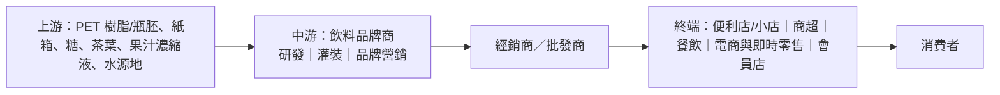

# 非酒精飲料行業研究報告｜轉弱觀察

- **更新日**：2026-10-18（Asia/Hong_Kong）
- **Dashboard 標籤**：轉弱觀察｜行業組「非酒精飲料」｜成份股 9633.HK 農夫山泉（n=1）
- **技術備註**：技術數據截至 2026-10-16，由 HK Indices DB 提供，本報告未重算。n=1；5d −1.0%、20d +5.8%；5d 廣度 0%（較前值 −100 ppt）。訊號完全等同單一成份股波動。
- **資料新鮮度**：公司數據以 2025 年報（2026-04）及 2026 中期業績（2026-07／08）為主；行業統計至 2026 年 1–8 月（國家統計局 2026-09-28）；市值以 2026-10-16 收市計。截至本更新日未見農夫山泉 2026 前三季數據（港股半年報披露制）。
- **非投資建議。**

---

## 1. 產業運作方式

**產業範圍。** 中國非酒精飲料（軟飲料）涵蓋包裝飲用水、即飲茶、功能飲料（能量／電解質）、果汁、碳酸飲料、咖啡及植物蛋白飲料等。國家統計局口徑「酒、飲料和精製茶製造業」2026 年 1–8 月營業收入 9,018.2 億元（同比 −7.7%）、利潤總額 1,431.0 億元（−34.7%）（來源 1）；該口徑含白酒，跌幅不宜直接套用於軟飲料，但反映消費品製造整體偏弱。

**主要商業模式。**
1. **品牌＋大單品驅動**：龍頭以少數億元級單品支撐規模，如農夫山泉的天然水與東方樹葉、東鵬的能量飲料與「補水啦」電解質水（來源 2、3）。
2. **多層經銷＋終端冰櫃網絡**：廠商向經銷商預收款發貨，經銷商覆蓋小店、商超、餐飲及即時零售；農夫、康師傅等五大客戶佔收入均少於 30%（來源 4、5），客戶高度分散。
3. **產能貼近市場＋水源地資源**：包裝水運輸半徑短、單價低，產能佈局與物流成本決定盈利；農夫山泉以自有水源地建廠為壁壘（來源 2）。
4. **成本轉嫁**：主要成本為 PET 瓶胚、紙箱、糖、茶葉及果汁原料；PET 價格波動直接影響毛利率（來源 2、6）。

**關鍵成功因素。** (i) 品牌心智與品類定義權（如無糖茶）；(ii) 渠道密度與終端執行；(iii) 新品孵化與健康化（減糖、無糖、功能化）；(iv) 規模化採購與產能網絡；(v) 價格體系管控，避免價格戰侵蝕。

**當前週期。** 包裝水進入存量競爭與價格戰，第三方報道指 2026H1 包裝飲用水市場銷量／銷售額同比下滑（來源 7）；而無糖茶、功能／電解質飲料維持增長，成為龍頭增量來源（來源 2、3、8）。

---

## 2. 價值鏈分析

| 環節 | 特點 | 議價力 |
|---|---|---|
| 上游 | PET 屬石化下游商品，價格隨油價／供需波動 | 品牌商可透過鎖價、規模採購部分對沖（來源 6） |
| 中游 | 品牌商掌握定價與渠道 | 龍頭盈利能力差異大：農夫 2026H1 毛利率約 60.9%（來源 2）；康師傅 2025 年淨利潤率約 5.7%（45.0/790.7，來源 10） |
| 渠道 | 多層經銷、預收款 | 集中度低，無單一大客戶（來源 4、5） |

### 主要參與者（市值以 2026-10-16 收市計；HKD→USD 7.8476、CNY→USD 6.7220，來源 11、12）

#### (1) 農夫山泉｜9633.HK｜Dashboard 成份股
- **簡介**：中國包裝飲用水及軟飲料龍頭，五大分部為包裝水、即飲茶（東方樹葉、茶π等）、功能飲料、果汁及其他。2026H1 收益約 297.18 億元（+16.0%）、母公司擁有人應佔溢利約 88.87 億元（+16.6%）；茶飲料收益約 131.22 億元（+30.1%），佔比約 44.2%，包裝水收益僅約 +2.1%；毛利率約 60.9%（來源 2）。
- **主要客戶與營收占比**：2025 年五大客戶銷售合計少於 30%（來源 4）；具名客戶：公開資訊有限。
- **主要供應商**：五大供貨商採購合計少於 30%（來源 4）；具名：公開資訊有限。
- **近 3 年營收與獲利**（人民幣億元；來源 9）

| 年度 | 2023 | 2024 | 2025 |
|---|---:|---:|---:|
| 收益 | 426.7 | 429.0（+0.5%） | 525.5（+22.5%） |
| 淨利潤 | 120.8 | 121.2（+0.4%） | 158.6（+30.8%） |

- **市值**：約 4,633.5 億港元 ≈ **590 億美元**（2026-10-16；來源 13）

#### (2) 華潤飲料｜2460.HK
- **簡介**：「怡寶」純淨水品牌擁有者，產品以包裝飲用水為主，亦有茶飲（至本清潤、佐味茶事等）。2026H1 收入 54.55 億元（−12.1%），歸屬股東利潤 5.92 億元（約 −26%）；包裝水收入 48.38 億元（−7.9%，佔 88.7%），飲料收入 6.17 億元（−35.4%）（來源 14）。
- **主要客戶與營收占比**：2025 年最大客戶佔收入 6.9%，前五大客戶佔 16.8%（來源 15）。
- **主要供應商**：最大供應商佔採購 9.5%，前五大佔 25.3%（來源 15）。
- **近 3 年營收與獲利**（人民幣億元；來源 16）

| 年度 | 2023 | 2024 | 2025 |
|---|---:|---:|---:|
| 收入 | 135.2 | 135.2（+0.0%） | 110.0（−18.6%） |
| 淨利潤 | 13.3 | 16.4（+23.2%） | 9.8（−39.8%） |

- **市值**：約 173.1 億港元 ≈ **22 億美元**（2026-10-16；來源 17）

#### (3) 康師傅控股｜0322.HK
- **簡介**：方便麵及飲料龍頭，飲料業務含即飲茶、果汁、包裝水，並透過合作經營百事碳酸飲料。2025 年飲料分部收入約 501.2 億元，佔集團收入逾六成（來源 10）。
- **主要客戶與營收占比**：五大客戶佔銷售少於 30%（來源 5）。
- **主要供應商**：五大供應商佔採購少於 30%（來源 5）。
- **近 3 年營收與獲利**（人民幣億元；來源 10）

| 年度 | 2023 | 2024 | 2025 |
|---|---:|---:|---:|
| 收入 | 804.2 | 806.5（+0.3%） | 790.7（−2.0%） |
| 淨利潤 | 31.2 | 37.3（+19.8%） | 45.0（+20.5%） |

- **市值**：約 697.3 億港元 ≈ **89 億美元**（2026-10-16；來源 18）

#### (4) 統一企業中國｜0220.HK
- **簡介**：台灣統一企業旗下中國業務，飲料（茶飲、果汁、奶茶、咖啡）與方便麵並重；2025 年飲料分部收入約 194.7 億元（來源 19）。
- **主要客戶與營收占比**：五大客戶佔收入少於 30%（來源 20）。
- **主要供應商**：五大供應商佔採購約 51.23%，最大供應商約 25.78%；控股股東統一企業為五大供應商之一（來源 20）。
- **近 3 年營收與獲利**（人民幣億元；來源 19）

| 年度 | 2023 | 2024 | 2025 |
|---|---:|---:|---:|
| 收入 | 285.9 | 303.3（+6.1%） | 317.1（+4.6%） |
| 淨利潤 | 16.7 | 18.5（+10.9%） | 20.5（+10.9%） |

- **市值**：約 331.9 億港元 ≈ **42 億美元**（2026-10-16；來源 21）

#### (5) 東鵬飲料｜605499.SH／09980.HK
- **簡介**：中國能量飲料龍頭，並拓展電解質水「補水啦」、茶飲及咖啡。2026H1 營業收入 124.43 億元（+15.89%）、歸母淨利潤 28.67 億元（+20.72%）；電解質飲料收入 16.72 億元（+11.98%），佔主營 13.45%（來源 3）。
- **主要客戶與營收占比**：公開資訊有限（本報告未取得 A 股年報客戶集中度原文）。
- **主要供應商**：公開資訊有限。
- **近 3 年營收與獲利**（人民幣億元；來源 22）

| 年度 | 2023 | 2024 | 2025 |
|---|---:|---:|---:|
| 營業收入 | 112.6 | 158.4（+40.6%） | 208.8（+31.8%） |
| 淨利潤 | 20.4 | 33.3（+63.1%） | 44.1（+32.7%） |

- **市值**：約 812.5 億元人民幣（SA 口徑，股本 7.27 億股，可能未完整計入 H 股，此為估計）≈ **121 億美元**（2026-10-16；來源 23）

---

## 3. 產業重要趨勢

1. **包裝水由增量轉存量、價格戰延續**：農夫 2026H1 包裝水僅 +2.1%（來源 2），華潤飲料包裝水 −7.9%（來源 14）；第三方指 2026H1 包裝水市場量額同比下滑（來源 7）。
2. **無糖茶成第一增長曲線**：農夫茶飲料 +30.1%、佔比 44.2%，明顯超過包裝水（約 32.4%）成為第一大品類（來源 2）；反之華潤飲料飲料業務 −35.4%（來源 14），顯示品類紅利向品牌龍頭集中。
3. **功能化／電解質化**：東鵬電解質飲料 +11.98%（來源 3）；農夫功能飲料約 +15.5%（來源 2、24）；行業跟蹤研報認為無糖茶、功能飲料景氣相對確定（來源 8）。
4. **成本端回升**：農夫披露 PET 採購價上升；媒體指 PET 價格自約 6,300 元／噸升至約 9,000 元／噸量級（來源 2、6）。
5. **龍頭盈利分化**：農夫 2025 年淨利 +30.8%、東鵬 +32.7%，而華潤飲料 −39.8%（來源 9、16、22）。

---

## 4. 未來 12 個月催化劑與風險

### 潛在正面
- **茶飲與功能飲料持續放量**：若無糖茶維持雙位數增長，可抵銷包裝水疲弱（來源 2、8）。
- **龍頭份額集中**：價格戰中弱勢品牌（如華潤飲料飲料業務下滑，來源 14）讓出份額，利好渠道與品牌較強者（推論）。
- **盈利改善的防守型龍頭**：康師傅、統一中國 2025 年淨利分別 +20.5%、+10.9%（來源 10、19），在收入平淡下以成本與結構改善支撐盈利。

### 潛在負面
- **包裝水價格戰再起**：直接壓縮行業定價錨與毛利（來源 7、14）。
- **PET 成本壓力於下半年顯現**：鎖價庫存消耗後成本上升或與促銷加劇疊加（來源 6）。
- **消費品製造景氣疲弱**：「酒、飲料和精製茶製造業」1–8 月利潤 −34.7%（來源 1）。
- **高基數**：農夫 2025 年收益 +22.5%、淨利 +30.8%（來源 9），2026H2 起面對高基數，增速放緩風險上升（推論）。
- **n=1 技術風險**：行業組技術訊號完全由農夫主導。

---

## 5. 資料限制
- 國家統計局口徑含酒類，非純軟飲料數據。
- 包裝水市場量額下滑、PET 價格屬第三方／媒體報道，未核對原始數據庫。
- 東鵬客戶／供應商集中度及 H 股計入後的總市值未能取得原文。
- 3 年財務為 S&P Global MI 標準化口徑。
- 技術數據截至 2026-10-16，未重算。

## 6. 來源列表
| # | 機構／文件 | 日期 | URL |
|---|---|---|---|
| 1 | 國家統計局：2026年1—8月份規模以上工業企業利潤 | 2026-09-28 | https://www.stats.gov.cn/sj/zxfb/202609/t20260928_1965425.html |
| 2 | 農夫山泉 2026 中期業績公告（HKEX） | 2026-08-25 | https://www.hkexnews.hk/listedco/listconews/sehk/2026/0825/2026082501293_c.pdf |
| 3 | 東鵬飲料 2026 年半年度報告（巨潮資訊） | 2026-07-31 | https://static.cninfo.com.cn/finalpage/2026-07-31/1225449594.PDF |
| 4 | 農夫山泉 2025 年度報告（HKEX） | 2026-04-17 | https://www1.hkexnews.hk/listedco/listconews/sehk/2026/0417/2026041701390_c.pdf |
| 5 | 康師傅控股 2025 年報（HKEX） | 2026-04-27 | https://www1.hkexnews.hk/listedco/listconews/sehk/2026/0427/2026042700362_c.pdf |
| 6 | 界面新聞：PET 成本報道 | 2026-08 | https://www.jiemian.com/article/15009129.html |
| 7 | 東方財富網：包裝水行業報道 | 2026-09 | https://finance.eastmoney.com/a/202609153875095988.html |
| 8 | 軟飲料行業跟蹤報告（東方財富研報 PDF） | 約 2026-04 | https://pdf.dfcfw.com/pdf/H3_AP202604171821280551_1.pdf |
| 9 | StockAnalysis：農夫山泉財務摘要（S&P Global MI） | 2026-10-16 查閱 | https://stockanalysis.com/quote/hkg/9633/financials/ |
| 10 | StockAnalysis：康師傅財務摘要（含分部） | 2026-10-16 查閱 | https://stockanalysis.com/quote/hkg/0322/financials/ |
| 11 | TMA USD/HKD 即期匯率 7.8476 | 2026-10-16 | https://benchmark.tma.org.hk/benchmark/history/usd-hk-spot-rate |
| 12 | 新華網：人民幣匯率中間價 6.7220 | 2026-10-16 | https://www.news.cn/20261016/7095dae31ecc47eeb2ea7679834be269/c.html |
| 13 | StockAnalysis：農夫山泉概覽（市值） | 2026-10-16 | https://stockanalysis.com/quote/hkg/9633/ |
| 14 | 財經網：華潤飲料 2026 上半年收入 54.55 億元 | 2026-08-26 | http://industry.caijing.com.cn/20260826/5179784.shtml |
| 15 | 華潤飲料 2025 年年報（HKEX） | 2026-04-24 | https://www1.hkexnews.hk/listedco/listconews/sehk/2026/0424/2026042401491_c.pdf |
| 16 | StockAnalysis：華潤飲料財務摘要 | 2026-10-17 查閱 | https://stockanalysis.com/quote/hkg/2460/financials/ |
| 17 | StockAnalysis：華潤飲料概覽 | 2026-10-16 | https://stockanalysis.com/quote/hkg/2460/ |
| 18 | StockAnalysis：康師傅概覽 | 2026-10-16 | https://stockanalysis.com/quote/hkg/0322/ |
| 19 | StockAnalysis：統一企業中國財務摘要 | 2026-10-16 查閱 | https://stockanalysis.com/quote/hkg/0220/financials/ |
| 20 | 統一企業中國 2025 年年報（HKEX） | 2026-04-27 | https://www1.hkexnews.hk/listedco/listconews/sehk/2026/0427/2026042700615_c.pdf |
| 21 | StockAnalysis：統一企業中國概覽 | 2026-10-16 | https://stockanalysis.com/quote/hkg/0220/ |
| 22 | StockAnalysis：東鵬飲料財務摘要 | 2026-10-16 查閱 | https://stockanalysis.com/quote/sha/605499/financials/ |
| 23 | StockAnalysis：東鵬飲料概覽 | 2026-10-16 | https://stockanalysis.com/quote/sha/605499/ |
| 24 | 新浪財經：農夫山泉業績解讀 | 2026-08-26 | https://finance.sina.com.cn/roll/2026-08-26/doc-iniprytq2305419.shtml |
