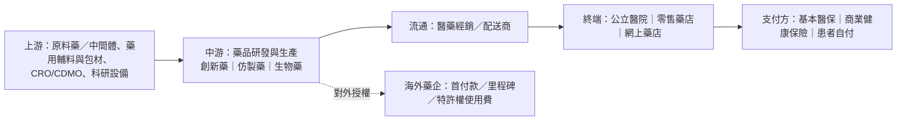

# 藥品製造（專科／仿製）行業研究報告｜轉強觀察

- **更新日**：2026-10-18（Asia/Hong_Kong）
- **Dashboard 標籤**：轉強觀察｜行業組「藥品製造（專科／仿製）」｜成份股 03692.HK 翰森製藥（n=1）
- **技術備註**：技術數據截至 2026-10-16，由 HK Indices DB 提供，本報告未重算。n=1；5d +0.6%、20d −6.8%；5d 廣度 100%（較前值 +100 ppt）；DB 標籤「持續弱＋短線反彈」。單一成份訊號易受個股波動主導。
- **資料新鮮度**：公司數據以 2025 年報（2026-03／04 刊發）及 2026 中期業績（2026-08）為主；行業統計至 2026 年 1–8 月（國家統計局 2026-09-28）；市值以 2026-10-16 收市計。截至本更新日未見各公司 2026 前三季業績（恒瑞 A 股預約披露日：StockAnalysis 列 2026-10-27、同花順列 2026-10-28，以交易所公告為準，來源 4）。
- **非投資建議。**

---

## 1. 產業運作方式

**產業定位。** 中國藥品製造業由化學藥（創新藥、仿製藥、改良型新藥）、生物藥及中藥構成；HK Indices DB 的「專科／仿製」組對應以處方藥為主、創新藥收入佔比持續上升的企業。2026 年 1–8 月，全國規模以上醫藥製造業營業收入 15,045.6 億元（同比 −0.3%）、利潤總額 2,119.6 億元（+3.9%），顯示行業整體量價趨平、利潤率略升（來源 1）。

**主要商業模式。**
1. **仿製藥／集採模式**：通用名藥透過國家組織集中帶量採購（「以量換價」）進入公立醫院。第 12 批集採（2026-07-31 開標）65 個品種全部採購成功，327 家企業 521 個產品擬中選，累計 12 批已覆蓋 555 種藥品（來源 2）；媒體統計平均降幅約 63.44%（來源 3）。此模式毛利率低、比拼成本與產能。
2. **創新藥／醫保談判模式**：獨家創新藥經醫保目錄談判形成支付標準，以價換量。國辦發〔2026〕9 號（2026-04-14 發布）提出優化創新藥首發價格機制，支持高水平創新藥「在上市初期制定與高投入、高風險相符的價格，在一定時期內保持價格相對穩定」，並推動商業健康保險創新藥目錄（來源 5）。2026 年醫保目錄及商保創新藥目錄調整方案已於 2026-05-31 發布（來源 6）。
3. **對外授權（License-out）模式**：中國藥企以海外權益換取首付款、里程碑及特許權使用費。國家醫保局轉引數據指 2026 年上半年中國創新藥對外授權交易額超過 1,000 億美元（來源 7）；媒體統計共 81 筆、首付款約 50 億美元（來源 8）。

**分銷與收款。** 藥企一般向醫藥經銷商（配送商）銷售，經銷商配送至醫院／藥店；以翰森為例，客戶為藥品經銷商，五大客戶佔銷售不足 30%（來源 9）。公立醫療機構藥品須於省級醫藥採購平台掛網並零差率銷售（來源 5）。

**關鍵成功因素。** (i) 研發管線深度與臨床推進效率（翰森 2026H1 研發開支佔收入 20.9%，來源 10）；(ii) 創新藥收入佔比以對沖仿製藥集採降價；(iii) 醫保准入與商業化團隊覆蓋；(iv) 國際化 BD 與海外監管獲批能力；(v) 原料藥＋製劑一體化與成本控制（國辦發 9 號亦支持「原輔料＋制劑」一體化，來源 5）。

---

## 2. 價值鏈分析

| 環節 | 主要內容 | 定價／議價力 |
|---|---|---|
| 上游 | 原料藥、輔料、包材、CRO/CDMO | 國辦發 9 號要求防範關鍵輔料、包材無序漲價（來源 5） |
| 中游 | 創新藥／仿製藥研發生產 | 仿製藥受集採價格約束；創新藥透過首發價與醫保談判定價（來源 2、5） |
| 流通 | 經銷配送 | 佣金型，藥企一般不委聘經銷商做推廣（翰森，來源 9） |
| 終端／支付 | 醫院、藥店；醫保＋商保 | 醫保支付標準為核心定價錨（來源 5、6） |

### 主要參與者（市值以 2026-10-16 收市計；HKD→USD 以 7.8476、CNY→USD 以 6.7220 換算，來源 11、12）

#### (1) 翰森製藥｜03692.HK｜Dashboard 成份股
- **簡介**：中國創新驅動型製藥企業，聚焦抗腫瘤、代謝、自身免疫、CNS、抗感染；在中國產生銷售收入的創新藥共 7 款。2026H1 收入 83.04 億元（+11.7%），創新藥收入 70.92 億元，佔 85.4%；腫瘤領域收入 54.73 億元（佔 65.9%）；溢利 42.58 億元（+35.8%）。2026-06 將 IL-23R 拮抗劑 HS-20118 海外權益授予 Avere（首付款 1.2 億美元、里程碑最高 21.8 億美元）（來源 10）。
- **主要客戶與營收占比**：客戶為藥品經銷商；2025 年五大客戶佔總銷售不足 30%，無單一客戶佔收入 ≥10%（來源 9、13）。具名客戶：公開資訊有限。
- **主要供應商**：五大供應商佔採購不足 30%（來源 9）；具名供應商：公開資訊有限。
- **近 3 年營收與獲利**（人民幣億元；來源 14，S&P Global MI 口徑）

| 年度 | 2023 | 2024 | 2025 |
|---|---:|---:|---:|
| 收入 | 101.0 | 122.6（+21.3%） | 150.3（+22.6%） |
| 年內溢利 | 32.8 | 43.7（+33.4%） | 55.5（+27.1%） |

- **市值**：約 1,924.3 億港元 ≈ **245 億美元**（2026-10-16；來源 15）

#### (2) 江蘇恒瑞醫藥｜600276.SH／01276.HK
- **簡介**：中國最大的創新藥企業之一，覆蓋腫瘤、代謝及心血管、免疫呼吸、神經等領域；2025 年收入 316.3 億元，其中境外收入約 47.7 億元（來源 16）。2026 上半年與 BMS 交易涉及確定性付款 9.5 億美元（媒體統計，來源 8）。
- **主要客戶與營收占比**：2025 年最大客戶佔總收入 25.82%，前五大客戶佔 55.7%（來源 17）；具名客戶：公開資訊有限。
- **主要供應商**：最大供應商佔採購 7.68%，前五大佔 28.7%（來源 17）。
- **近 3 年營收與獲利**（人民幣億元；來源 16）

| 年度 | 2023 | 2024 | 2025 |
|---|---:|---:|---:|
| 收入 | 228.2 | 279.9（+22.6%） | 316.3（+13.0%） |
| 淨利潤 | 43.0 | 63.4（+47.3%） | 77.1（+21.7%） |

- **市值**：約 3,071.1 億元人民幣（以 A 股價×A+H 總股本，S&P/SA 口徑）≈ **457 億美元**（2026-10-16；來源 18）

#### (3) 石藥集團｜01093.HK（DB 歸類「藥品製造（綜合）」，作同業參照）
- **簡介**：綜合型藥企，業務含成藥（神經、腫瘤、抗感染等）、原料藥（維生素 C、抗生素）及功能食品。2025 年收入下滑主因腫瘤等成藥板塊受集採／價格壓力（腫瘤收入由 2023 年 61.4 億元降至 2025 年 22.0 億元），授權費收入 2025 年約 17.9 億元（來源 19）。2026 上半年與阿斯利康交易首付款 12 億美元（媒體統計，來源 8）。
- **主要客戶與營收占比**：五大客戶佔收入少於 30%（來源 20）；具名：公開資訊有限。
- **主要供應商**：五大供應商佔採購少於 30%（來源 20）。
- **近 3 年營收與獲利**（人民幣億元；來源 19）

| 年度 | 2023 | 2024 | 2025 |
|---|---:|---:|---:|
| 收入 | 314.5 | 290.1（−7.8%） | 260.1（−10.4%） |
| 淨利潤 | 58.7 | 43.3（−26.3%） | 38.8（−10.3%） |

- **市值**：約 1,013.7 億港元 ≈ **129 億美元**（2026-10-16；來源 21）

#### (4) 中國生物製藥｜01177.HK
- **簡介**：研發驅動型綜合藥企，產品涵蓋腫瘤（安羅替尼等）、肝病、呼吸、外科／鎮痛等，並含現代中藥（來源 22）。2025 年收入增長 10.3%，但淨利受非經營因素影響下滑。
- **主要客戶與營收占比**：五大客戶佔銷售不超過 30%（來源 23）；具名：公開資訊有限。
- **主要供應商**：五大供應商佔採購不超過 30%（來源 23）。
- **近 3 年營收與獲利**（人民幣億元；來源 24）

| 年度 | 2023 | 2024 | 2025 |
|---|---:|---:|---:|
| 收入 | 262.0 | 288.7（+10.2%） | 318.3（+10.3%） |
| 淨利潤 | 23.3 | 35.0（+50.1%） | 23.4（−33.1%） |

- **市值**：約 935.0 億港元 ≈ **119 億美元**（2026-10-16；來源 22）

#### (5) 三生製藥｜01530.HK
- **簡介**：生物製藥企業，產品含特比澳（TPIAO）、益比奧（EPIAO）等；2025 年將 PD-1/VEGF 雙抗 SSGJ-707 授權予輝瑞（首付款 12.5 億美元、潛在里程碑最高 48 億美元），2025 年確認授權收入約 94.26 億元（來源 25）。
- **主要客戶與營收占比**：2025 年五大客戶佔總收益約 60.5%（2024 年 14.0%），單一最大客戶約 53.7%（2024 年 3.8%）（來源 26）；結合授權收入規模，最大客戶與輝瑞授權交易相關，惟年報未具名，屬推斷。
- **主要供應商**：五大供應商佔採購約 20.3%，最大供應商約 6.4%（來源 26）。
- **近 3 年營收與獲利**（人民幣億元；來源 27）

| 年度 | 2023 | 2024 | 2025 |
|---|---:|---:|---:|
| 收入 | 78.2 | 91.1（+16.5%） | 177.0（+94.3%） |
| 淨利潤 | 15.5 | 20.9（+34.9%） | 84.8（+305.8%） |

- **市值**：約 360.6 億港元 ≈ **46 億美元**（2026-10-16；來源 28）

---

## 3. 產業重要趨勢

1. **創新藥收入佔比上升成為盈利主引擎**：翰森 2025 年創新藥與合作產品收入佔 82.2%，2026H1 創新藥收入佔 85.4%（來源 10、13）；石藥則顯示集採／價格壓力下傳統成藥收入下滑（來源 19）。行業分化在於「創新收入能否覆蓋仿製藥降價」。
2. **對外授權規模創新高、收入結構一次性化**：2026H1 對外授權交易額超千億美元（來源 7），三生 2025 年授權收入佔收入過半（來源 25、27）。首付款帶來利潤跳升，但可持續性取決於里程碑兌現。
3. **定價機制由「壓價」轉向「分層定價」**：國辦發 9 號區分高水平創新藥、改良新藥與通用名藥，並強化商保多元支付及真實世界研究評估（來源 5）。
4. **集採持續擴面並強調「反內卷」**：第 12 批集採對異常低價設兩檔防範措施，強調穩臨床、保質量（來源 2）；集採覆蓋面擴大意味仿製藥收入長期承壓。
5. **行業整體增長放緩**：2026 年 1–8 月醫藥製造業收入 −0.3%、利潤 +3.9%（來源 1），結構性增長集中於創新藥企。

---

## 4. 未來 12 個月催化劑與風險

### 潛在正面
- **2026 年醫保目錄／商保創新藥目錄結果公布**（方案 2026-05-31 發布，來源 6）：新增創新藥准入可帶動放量；商保目錄為高價創新藥提供額外支付渠道（來源 5）。
- **首發價格機制落地**：高水平創新藥上市初期價格相對穩定，改善新藥回報預期（來源 5）。
- **BD 里程碑與海外獲批**：翰森阿美替尼已於 2026-02 獲歐盟批准，HS-20118 授權含最高 21.8 億美元里程碑（來源 10）；行業 BD 規模擴大（來源 7）。
- **管線進入註冊期**：翰森 2026H1 新增 3 項上市申請獲受理、3 項 III 期（來源 29）。

### 潛在負面
- **集採擴面衝擊仿製藥**：第 12 批集採結果年內實施（來源 30）；公開中選名單顯示江蘇豪森（翰森附屬）為恩紮盧胺中選企業之一（第三方整理，來源 31），相關產品價格或下行（翰森恩紮盧胺軟膠囊列於其腫瘤產品組合，來源 10）。
- **授權收入一次性與可比基數**：三生 2025 年高基數（來源 27）；SA 數據顯示其 TTM 收入增長已回落至約 +1%（來源 27）。
- **醫保談判降價幅度不確定**：支付標準須「在醫保基金可承受前提下」形成（來源 5）。
- **行業收入停滯**：醫藥製造業 1–8 月收入負增長（來源 1）。
- **地緣與海外監管風險**：對外授權依賴海外合作方開發決策（推論，非具體事件）。

---

## 5. 資料限制
- DB 本組 n=1，行業結論以翰森為中心；同業選自 A／H 代表性企業，石藥在 DB 屬「綜合」組。
- 3 年財務採 S&P Global Market Intelligence（經 StockAnalysis）標準化口徑，與公司公告「年內溢利／歸母淨利」或有差異。
- 恒瑞市值以 A 股價×A+H 總股本計，屬第三方口徑。
- 第 12 批集採平均降幅 63.44% 及中選名單整理來自媒體／第三方，官方附件未逐一核對。
- 具名客戶與供應商：各公司年報僅披露集中度百分比。
- 技術數據截至 2026-10-16，未重算。

## 6. 來源列表
| # | 機構／文件 | 日期 | URL |
|---|---|---|---|
| 1 | 國家統計局：2026年1—8月份全國規模以上工業企業利潤 | 2026-09-28 | https://www.stats.gov.cn/sj/zxfb/202609/t20260928_1965425.html |
| 2 | 國家醫保局：第12批國家組織藥品集採開標 | 2026-07-31 | http://www.nhsa.gov.cn/art/2026/7/31/art_14_21646.html |
| 3 | 健康界（healthcarechn）：第12批集採平均降幅63.44% | 2026-08-06 | https://m.healthcarechn.com/h-nd-3327.html |
| 4 | StockAnalysis：恒瑞醫藥（SHA:600276）概覽（業績日） | 2026-10-16 | https://stockanalysis.com/quote/sha/600276/ |
| 5 | 國務院辦公廳：國辦發〔2026〕9號 | 2026-04-14 | https://www.gov.cn/zhengce/zhengceku/202604/content_7065542.htm |
| 6 | 國家醫保局：2026年醫保目錄及商保創新藥目錄調整工作方案 | 2026-05-31 | https://www.nhsa.gov.cn/art/2026/5/31/art_109_20816.html |
| 7 | 國家醫保局：上半年創新藥對外授權交易額超千億美元 | 2026-07-14 | https://www.nhsa.gov.cn/art/2026/7/14/art_14_21423.html |
| 8 | 新浪財經：中國創新藥出海規模突破千億美元 | 2026-08-14 | https://finance.sina.com.cn/jjxw/2026-08-14/doc-ininhtfh4130992.shtml |
| 9 | 翰森製藥 2025 年報（HKEX） | 2026-04-28 | https://www1.hkexnews.hk/listedco/listconews/sehk/2026/0428/2026042803832_c.pdf |
| 10 | 翰森製藥 2026 中期業績公告（HKEX） | 2026-08-26 | https://www.hkexnews.hk/listedco/listconews/sehk/2026/0826/2026082600591_c.pdf |
| 11 | 香港財資市場公會（TMA）USD/HKD 即期匯率 7.8476 | 2026-10-16 | https://benchmark.tma.org.hk/benchmark/history/usd-hk-spot-rate |
| 12 | 新華網：人民幣匯率中間價（100美元=672.20元） | 2026-10-16 | https://www.news.cn/20261016/7095dae31ecc47eeb2ea7679834be269/c.html |
| 13 | 翰森製藥 2025 年度業績公告（HKEX） | 2026-03-29 | https://www.hkexnews.hk/listedco/listconews/sehk/2026/0329/2026032900706_c.pdf |
| 14 | StockAnalysis：翰森製藥財務摘要（S&P Global MI） | 2026-10-16 查閱 | https://stockanalysis.com/quote/hkg/3692/financials/ |
| 15 | StockAnalysis：翰森製藥概覽（市值） | 2026-10-16 | https://stockanalysis.com/quote/hkg/3692/ |
| 16 | StockAnalysis：恒瑞醫藥財務摘要 | 2026-10-16 查閱 | https://stockanalysis.com/quote/sha/600276/financials/ |
| 17 | 恒瑞醫藥 2025 年度報告（H 股，HKEX） | 2026-03-26 | https://www1.hkexnews.hk/listedco/listconews/sehk/2026/0326/2026032600034_c.pdf |
| 18 | StockAnalysis：恒瑞醫藥概覽（市值） | 2026-10-16 | https://stockanalysis.com/quote/sha/600276/ |
| 19 | StockAnalysis：石藥集團財務摘要（含分部） | 2026-10-16 查閱 | https://stockanalysis.com/quote/hkg/1093/financials/ |
| 20 | 石藥集團 2025 年度報告（HKEX） | 2026-04-28 | https://www1.hkexnews.hk/listedco/listconews/sehk/2026/0428/2026042803422_c.pdf |
| 21 | StockAnalysis：石藥集團概覽 | 2026-10-16 | https://stockanalysis.com/quote/hkg/1093/ |
| 22 | StockAnalysis：中國生物製藥概覽 | 2026-10-16 | https://stockanalysis.com/quote/hkg/1177/ |
| 23 | 中國生物製藥 二零二五年年報（HKEX） | 2026-04-29 | https://www1.hkexnews.hk/listedco/listconews/sehk/2026/0429/2026042901037_c.pdf |
| 24 | StockAnalysis：中國生物製藥財務摘要 | 2026-10-17 查閱 | https://stockanalysis.com/quote/hkg/1177/financials/ |
| 25 | 三生製藥 2025 年度業績公告（HKEX） | 2026-03-30 | https://www.hkexnews.hk/listedco/listconews/sehk/2026/0330/2026033002399_c.pdf |
| 26 | 三生製藥 2025 年度報告（HKEX） | 2026-04-29 | https://www1.hkexnews.hk/listedco/listconews/sehk/2026/0429/2026042904533_c.pdf |
| 27 | StockAnalysis：三生製藥財務摘要（含地區收入） | 2026-10-16 查閱 | https://stockanalysis.com/quote/hkg/1530/financials/ |
| 28 | StockAnalysis：三生製藥概覽 | 2026-10-16 | https://stockanalysis.com/quote/hkg/1530/ |
| 29 | 美通社：翰森製藥 2026 中期業績新聞稿 | 2026-08-26 | https://www.prnasia.com/story/545332-1.shtml |
| 30 | 國家醫保局：第12批集採中選結果通知 | 2026-08-06 | https://www.nhsa.gov.cn/art/2026/8/6/art_187_21682.html |
| 31 | 十大品牌網：第十二批集採中選名單整理（第三方） | 2026-08-15 | https://www.cnpp.cn/focus/3566356.html |
