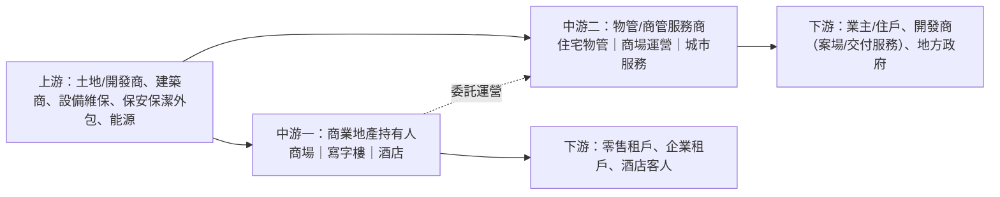

# 地產服務行業研究報告｜轉弱觀察

- **更新日**：2026-10-18（Asia/Hong_Kong）
- **Dashboard 標籤**：轉弱觀察｜行業組「地產服務」（Real Estate Services）｜成份股 0101.HK 恒隆地產、1209.HK 華潤萬象生活、1997.HK 九龍倉置業（n=3）
- **技術備註**：技術數據截至 2026-10-16，由 HK Indices DB 提供，本報告未重算。n=3；5d −0.4%、20d +1.4%；5d 廣度 33%（較前值 −33 ppt）。組內分化大。
- **資料新鮮度**：公司數據以 2025 年報（2026-03／04）及 2026 中期業績（2026-07／08）為主；內地房地產統計至 2026 年 1–8 月（國家統計局 2026-09-15）；市值以 2026-10-16 收市計。
- **非投資建議。**

---

## 1. 產業運作方式

**產業範圍。** 本 Dashboard 的「地產服務」行業組按國際分類口徑，涵蓋兩類港股：(i) **商業地產持有及營運商**（收租股，如恒隆地產、九龍倉置業、太古地產），以購物中心、寫字樓及酒店租金為主要收入；(ii) **物業管理及商業運營服務商**（如華潤萬象生活、中海物業），按管理面積收取物管費，並提供購物中心輕資產運營。兩者與開發商不同，收入以經常性租金／服務費為主。

**行業背景。** 內地開發端仍深度調整：2026 年 1–8 月全國房地產開發投資 47,979 億元（同比 −19.9%）、新建商品房銷售額 47,470 億元（−13.0%）、房屋竣工面積 −23.7%；二手房網簽面積則 +10.6%（來源 1）。竣工及新盤交付收縮，直接減少物管新增面積及案場等「非業主增值服務」（來源 2）。

**主要商業模式。**
1. **重資產收租**：持有核心地段商場與寫字樓，收入＝面積×租用率×租金（含零售額分成），受消費及辦公需求驅動，並有公允值重估波動（來源 3、4）。
2. **物管「包乾制」**：按面積收取固定物管費，毛利率低、收繳率決定現金流（來源 5、6）。
3. **輕資產商管**：為母公司或第三方商場提供招商與運營，收取管理費，毛利率較物管高（來源 2）。

**關鍵成功因素。** (i) 資產區位與品牌（高端商場抗週期）；(ii) 母公司資源（關聯方面積、商場儲備）；(iii) 第三方外拓與收繳能力；(iv) 資產負債表與派息能力；(v) 成本控制（物管人工佔比高）。

---

## 2. 價值鏈分析

| 環節 | 特點 | 關鍵風險 |
|---|---|---|
| 開發商 | 交付面積決定物管增量 | 竣工面積 −23.7%（來源 1） |
| 收租業主 | 租金與重估 | 寫字樓租金下行、重估減值（來源 3、4） |
| 物管／商管 | 經常性收費 | 收繳率下滑、降價壓力（來源 5、6、7） |

### 主要參與者（市值以 2026-10-16 收市計；HKD→USD 7.8476，來源 8）

#### (1) 恒隆地產｜0101.HK｜Dashboard 成份股
- **簡介**：香港及內地高端商場與寫字樓持有人，內地「66」系列商場（上海港匯恒隆、恒隆廣場等）為核心。2026H1 物業租賃收入約 49.23 億港元（+5%）；內地商場收入按人民幣計約 +6%、租出率約 96%、租戶銷售額約 +17%；內地辦公樓租賃收入約 −12%（來源 3）。
- **主要客戶與營收占比**：五大客戶佔收入不超過 30%（來源 9）。
- **主要供應商**：五大供應商佔採購不超過 30%（來源 9）。
- **近 3 年營收與獲利**（港元億元；來源 10）

| 年度 | 2023 | 2024 | 2025 |
|---|---:|---:|---:|
| 收入 | 103.5 | 112.7（+8.9%） | 99.5（−11.7%） |
| 淨利潤 | 39.7 | 21.5（−45.8%） | 18.1（−16.1%） |

- **市值**：約 333.0 億港元 ≈ **42 億美元**（2026-10-16；來源 11）

#### (2) 華潤萬象生活｜1209.HK｜Dashboard 成份股
- **簡介**：華潤置地旗下物管及商業運營平台，業務分為物業管理及商業運營（購物中心「萬象城」等）。2026H1 收入約 92.17 億元（+8.1%）、核心淨利約 22.29 億元（+10.8%），中期加特別股息約對應核心淨利 100% 分派；非業主增值服務約 −10.3%（來源 2）。
- **主要客戶與營收占比**：2025 年五大客戶佔 35.5%，最大客戶華潤置地佔 28.1%（來源 12）。
- **主要供應商**：五大供應商佔 7.5%，最大供應商（華潤置地）佔 3.2%（來源 12）。
- **近 3 年營收與獲利**（人民幣億元；來源 13）

| 年度 | 2023 | 2024 | 2025 |
|---|---:|---:|---:|
| 收入 | 147.7 | 171.5（+16.2%） | 180.2（+5.1%） |
| 淨利潤 | 29.3 | 36.0（+22.8%） | 39.7（+10.3%） |

- 2025 年分部：物業管理約 108.5 億元、商業運營約 69.1 億元（來源 13）。
- **市值**：約 905.7 億港元 ≈ **115 億美元**（2026-10-16；來源 14）

#### (3) 九龍倉置業｜1997.HK｜Dashboard 成份股
- **簡介**：持有海港城、時代廣場等香港核心商場、寫字樓及酒店。2026 年中期基礎淨利約 33.11 億港元（+6%）；派息比率由 65% 調升至 90%，第一次中期息每股 94 港仙（+42%）；資產出售完成後負債率目標約 11%；投資物業收入約 −2%（來源 4）。
- **主要客戶與營收占比**：五大客戶佔收入少於 30%（來源 15）。
- **主要供應商**：五大供應商佔採購少於 30%（來源 15）。
- **近 3 年營收與獲利**（港元億元；來源 16）

| 年度 | 2023 | 2024 | 2025 |
|---|---:|---:|---:|
| 收入 | 133.1 | 129.1（−3.0%） | 128.2（−0.7%） |
| 淨利潤 | 47.7 | 8.9（−81.3%） | −42.6（報表轉虧） |

- 2025 年分部：投資物業約 106.5 億港元、酒店約 16.3 億港元（來源 16）。
- **市值**：約 924.8 億港元 ≈ **118 億美元**（2026-10-16；來源 17）

#### (4) 太古地產｜1972.HK
- **簡介**：太古集團旗下，持有太古廣場、太古坊及內地太古里等。2026H1 收入 94.13 億港元（+8%）；股東應佔基本溢利約 49 億港元（+11%），經常性基本溢利 46.61 億港元（+36%）；寫字樓租金收入 26.38 億港元，與上年大致相約，香港寫字樓租用率約 90%；第一次中期股息每股 0.37 港元（+6%）（來源 18）。
- **主要客戶與營收占比**：五大客戶佔收入少於 30%（來源 19）。
- **主要供應商**：五大供應商佔採購少於 30%（來源 19）。
- **近 3 年營收與獲利**（港元億元；來源 20）

| 年度 | 2023 | 2024 | 2025 |
|---|---:|---:|---:|
| 收入 | 155.0 | 157.0（+1.3%） | 166.0（+5.7%） |
| 淨利潤 | 26.4 | −7.7（轉虧） | −15.3（報表虧損擴大） |

- **市值**：約 1,407.1 億港元 ≈ **179 億美元**（2026-10-16；來源 21）

#### (5) 中海物業｜2669.HK
- **簡介**：中國海外集團旗下物管公司，以住宅及商業物管、增值服務及城市服務為主。2026H1 收益 74.85 億元（+4.5%）、普通股權持有人應佔溢利 7.01 億元（−9.0%）（來源 22）；媒體指毛利率降至 14.9%，受物管費降價壓力影響（來源 7）。
- **主要客戶與營收占比**：五大客戶佔收入少於 30%（來源 23）。
- **主要供應商**：五大供應商佔採購少於 30%（來源 23）。
- **近 3 年營收與獲利**（人民幣億元；來源 24）

| 年度 | 2023 | 2024 | 2025 |
|---|---:|---:|---:|
| 收益 | 130.5 | 141.1（+8.1%） | 149.6（+6.0%） |
| 淨利潤 | 13.4 | 15.1（+12.7%） | 13.7（−9.3%） |

- **市值**：約 109.8 億港元 ≈ **14 億美元**（2026-10-16；來源 25）

---

## 3. 產業重要趨勢

1. **開發端收縮傳導至物管增量**：1–8 月竣工面積 −23.7%、新開工 −24.8%（來源 1）；萬象非業主增值服務 −10.3%（來源 2）。
2. **物管「質價矛盾」與收繳率下滑**：行業研究指住宅物管收繳率持續下行（來源 5、6）；中海物業「增收不增利」、毛利率降至 14.9%（來源 7、22）。
3. **高端商場與寫字樓分化**：恒隆內地商場收入 +6%、租戶銷售 +17%，但內地辦公樓 −12%（來源 3）；太古寫字樓租金持平、租用率約 90%（來源 18）。
4. **收租股轉向「去槓桿＋高派息」**：九倉派息比率升至 90%（來源 4）；萬象核心淨利 100% 分派（來源 2）。
5. **報表盈利波動大於基礎盈利**：收租股報表淨利潤含投資物業公允值變動；九倉 2025 年報表轉虧、太古 2025 年報表虧損（來源 16、20），而兩者 2026H1 基礎溢利分別 +6%、+11%（來源 4、18）。

---

## 4. 未來 12 個月催化劑與風險

### 潛在正面
- **高端消費回暖**：恒隆內地商場租戶銷售 +17%（來源 3），若延續可推動分成租金。
- **派息提升支撐估值**：九倉、萬象的高派息政策（來源 2、4）或吸引收息資金（推論）。
- **二手房成交回暖**：二手房網簽面積 +10.6%（來源 1），利好存量物管的增值服務（推論）。
- **商管輕資產擴張**：萬象商業運營佔 2025 年收入約 38%（69.1/180.2，來源 13），毛利較高。

### 潛在負面
- **竣工及交付持續下滑**：限制物管新增面積與案場服務（來源 1、2）。
- **收繳率及降價壓力**：壓縮物管毛利與現金流（來源 5、7）。
- **寫字樓供過於求**：內地辦公樓租金續跌（來源 3）；香港寫字樓租用率約 90%（來源 18），租金修復空間有限（推論）。
- **重估減值**：若資本化率上升，報表盈利再受壓（來源 16、20）。
- **關聯方依賴**：萬象最大客戶華潤置地佔 28.1%（來源 12），母公司交付節奏直接影響收入。

---

## 5. 資料限制
- Dashboard 行業分類把收租股與物管股合併，與純物管指數不同。
- 九倉中期數據取自媒體報道（881903），未核對公告原文。
- 收繳率為第三方研究，未取得官方統計。
- 中海物業毛利率 14.9% 取自媒體報道。
- 3 年財務為 S&P Global MI 標準化口徑；收租股淨利潤含重估。
- 具名客戶／供應商公開資訊有限（萬象除外）。
- 技術數據截至 2026-10-16，未重算。

## 6. 來源列表
| # | 機構／文件 | 日期 | URL |
|---|---|---|---|
| 1 | 國家統計局：2026年1—8月份全國房地產市場基本情況 | 2026-09-15 | https://www.stats.gov.cn/sj/zxfb/202609/t20260915_1965310.html |
| 2 | 華潤萬象生活 2026 中期業績公告（HKEX） | 2026-08-31 | https://www.hkexnews.hk/listedco/listconews/sehk/2026/0831/2026083100074_c.pdf |
| 3 | 恒隆地產 2026 中期業績 | 2026-07 | https://www.hanglung.com/getmedia/3efc3e5d-4168-4df3-8698-bd2e609c0e1f/C_HLP-2026-Interim-Results.pdf |
| 4 | 叱咤 881903：九龍倉置業中期業績報道 | 2026-08-06 | https://www.881903.com/news/finance/2643812 |
| 5 | 每日經濟新聞：物管收繳率報道 | 2026-03-04 | https://www.nbd.com.cn/articles/2026-03-04/4279265.html |
| 6 | 中國房地產網：物管行業數據 | 2026-02-27 | http://m.fangchan.com/data/369/2026-02-27/7434152004404187944.html |
| 7 | 東方財富網：中海物業上半年「增收不增利」 | 2026-08-20 | https://finance.eastmoney.com/a/202608203847977845.html |
| 8 | TMA USD/HKD 即期匯率 7.8476 | 2026-10-16 | https://benchmark.tma.org.hk/benchmark/history/usd-hk-spot-rate |
| 9 | 恒隆地產 2025 年報（HKEX） | 2026-03-26 | https://www1.hkexnews.hk/listedco/listconews/sehk/2026/0326/2026032600825_c.pdf |
| 10 | StockAnalysis：恒隆地產財務摘要（S&P Global MI） | 2026-10-16 查閱 | https://stockanalysis.com/quote/hkg/0101/financials/ |
| 11 | StockAnalysis：恒隆地產概覽（市值） | 2026-10-16 | https://stockanalysis.com/quote/hkg/0101/ |
| 12 | 華潤萬象生活 2025 年報（HKEX） | 2026-04-29 | https://www1.hkexnews.hk/listedco/listconews/sehk/2026/0429/2026042900140_c.pdf |
| 13 | StockAnalysis：華潤萬象生活財務摘要 | 2026-10-16 查閱 | https://stockanalysis.com/quote/hkg/1209/financials/ |
| 14 | StockAnalysis：華潤萬象生活概覽 | 2026-10-16 | https://stockanalysis.com/quote/hkg/1209/ |
| 15 | 九龍倉置業 2025 年報（HKEX） | 2026-04-09 | https://www1.hkexnews.hk/listedco/listconews/sehk/2026/0409/2026040900745_c.pdf |
| 16 | StockAnalysis：九龍倉置業財務摘要 | 2026-10-16 查閱 | https://stockanalysis.com/quote/hkg/1997/financials/ |
| 17 | StockAnalysis：九龍倉置業概覽 | 2026-10-16 | https://stockanalysis.com/quote/hkg/1997/ |
| 18 | 太古地產 2026 年中期業績（HKEX） | 2026-08-06 | https://www.hkexnews.hk/listedco/listconews/sehk/2026/0806/2026080600220_c.pdf |
| 19 | 太古地產 2025 年報（HKEX） | 2026-04-08 | https://www1.hkexnews.hk/listedco/listconews/sehk/2026/0408/2026040801496_c.pdf |
| 20 | StockAnalysis：太古地產財務摘要 | 2026-10-16 查閱 | https://stockanalysis.com/quote/hkg/1972/financials/ |
| 21 | StockAnalysis：太古地產概覽 | 2026-10-16 | https://stockanalysis.com/quote/hkg/1972/ |
| 22 | 中海物業 2026 中期業績公告（HKEX） | 2026-08-20 | https://www.hkexnews.hk/listedco/listconews/sehk/2026/0820/2026082000570_c.pdf |
| 23 | 中海物業 2025 年報（HKEX） | 2026-04-29 | https://www1.hkexnews.hk/listedco/listconews/sehk/2026/0429/2026042900390_c.pdf |
| 24 | StockAnalysis：中海物業財務摘要 | 2026-10-16 查閱 | https://stockanalysis.com/quote/hkg/2669/financials/ |
| 25 | StockAnalysis：中海物業概覽 | 2026-10-16 | https://stockanalysis.com/quote/hkg/2669/ |
