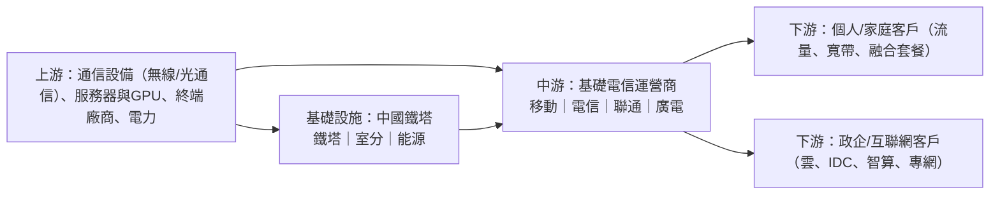

# 電訊服務行業研究報告｜高位轉弱觀察

- **更新日**：2026-10-18（Asia/Hong_Kong）
- **Dashboard 標籤**：轉弱觀察（高位轉弱）｜行業組「電訊服務」｜成份股 0728.HK 中國電信、0762.HK 中國聯通、0941.HK 中國移動（n=3）
- **技術備註**：技術數據截至 2026-10-16，由 HK Indices DB 提供，本報告未重算。n=3；5d −0.1%、20d +0.6%；5d 廣度 33%（較前值 −67 ppt）。成份股權重集中於中國移動。
- **資料新鮮度**：公司數據以 2025 年報（2026-03／04）及 2026 中期業績（2026-07／08）為主；行業統計至 2026 年 1–8 月（工信部 2026-09-28）；市值以 2026-10-16 收市計。截至本更新日未見三大運營商 2026 年第三季度經營數據。
- **非投資建議。**

---

## 1. 產業運作方式

**產業格局。** 中國基礎電信由中國移動、中國電信、中國聯通三家央企主導，另有中國廣電；鐵塔基礎設施集中於中國鐵塔。2026 年 1–8 月全國電信業務收入 1.16 萬億元，同比 −2.2%；但以上年不變價計算的電信業務總量 +7.6%（來源 1），量增而價（收入）承壓。截至 8 月末移動電話用戶 18.49 億戶，其中 5G 用戶 13.11 億戶（佔 70.9%）；固網寬帶用戶 7.04 億戶（來源 1）。

**主要商業模式。**
1. **連接（通信服務）**：移動語音／流量、固網寬帶、融合套餐；以 ARPU×用戶數變現，通話及短信持續萎縮（1–8 月移動通話時長 −6.7%、短信收入 −12.4%，來源 1）。
2. **算力與雲（第二曲線）**：IDC、公有雲（天翼雲、移動雲、聯通雲）、智算及 AI 平台，為政企／互聯網客戶提供雲網一體服務（來源 2、3、4）。
3. **共享基礎設施**：運營商向中國鐵塔租用鐵塔、室分及能源服務，鐵塔約 85% 收入來自運營商（來源 5）。
4. **香港市場**：HKT 等以固網、流動、媒體（Now TV）及企業方案為主，屬成熟高派息模式（來源 6）。

**關鍵成功因素。** (i) 頻譜與網絡覆蓋（5G 基站 519.5 萬個，佔移動基站 39.7%，來源 1）；(ii) 資本開支紀律與自由現金流；(iii) 政企／算力業務的增長與毛利；(iv) 國資考核與派息政策；(v) 監管及稅務口徑（2026 年起部分增值電信業務改按基礎電信 9% 稅率計稅，影響報表收入，來源 2、3、4）。

---

## 2. 價值鏈分析

| 環節 | 特點 | 議價力 |
|---|---|---|
| 上游 | 設備商、服務器／AI 芯片供應集中 | 移動前五大供應商佔採購約 21%（來源 7） |
| 基礎設施 | 鐵塔共享，客戶極度集中 | 鐵塔前五大客戶佔 85.4%（來源 5），對運營商依賴高 |
| 運營商 | 三家寡頭、國資背景 | 客戶極分散：移動前五大客戶僅佔約 3%（來源 7） |

### 主要參與者（市值以 2026-10-16 收市計；HKD→USD 7.8476、CNY→USD 6.7220，來源 8、9）

#### (1) 中國移動｜0941.HK（亦有 600941.SH）｜Dashboard 成份股
- **簡介**：全球客戶規模最大的電信運營商。2026H1 營運收入 5,380 億元（−1.1%，剔除增值稅稅目調整同口徑正增長）；股東應佔利潤 789 億元（−6.3%）；移動客戶 10.11 億戶；中期股息每股人民幣 2.51 元（來源 2）。算力服務收入約 529 億元（+14.0%）（來源 2）。
- **主要客戶與營收占比**：2025 年五大客戶銷售約人民幣 347 億元，佔約 3%（來源 7）。
- **主要供應商**：五大供應商採購約人民幣 1,550 億元，佔約 21%；最大供應商約 7%（來源 7）。
- **近 3 年營收與獲利**（人民幣億元；來源 10）

| 年度 | 2023 | 2024 | 2025 |
|---|---:|---:|---:|
| 營運收入 | 10,093.1 | 10,407.6（+3.1%） | 10,501.9（+0.9%） |
| 淨利潤 | 1,317.7 | 1,383.7（+5.0%） | 1,371.0（−0.9%） |

- **市值**：約 1.79 萬億港元 ≈ **2,281 億美元**（2026-10-16；來源 11）

#### (2) 中國電信｜0728.HK（亦有 601728.SH）｜Dashboard 成份股
- **簡介**：固網寬帶及雲業務領先運營商，旗下天翼雲。2026H1 經營收入 2,605 億元（上年同期 2,714.69 億元），主營收入 2,441 億元（可比口徑基本穩定）；股東應佔利潤 195.88 億元（上年同期 230.17 億元）；天翼雲收入 618 億元（+7.8%）、智能收入 311 億元（+7.1%）；中期派息比例 75%（來源 3）。
- **主要客戶與營收占比**：五大客戶佔收入少於 30%（來源 12）。
- **主要供應商**：五大供應商佔採購少於 30%（來源 12）。
- **近 3 年營收與獲利**（人民幣億元；來源 13）

| 年度 | 2023 | 2024 | 2025 |
|---|---:|---:|---:|
| 經營收入 | 5,135.5 | 5,235.7（+2.0%） | 5,239.2（+0.1%） |
| 淨利潤 | 304.5 | 330.1（+8.4%） | 331.9（+0.5%） |

- **市值**：約 6,883.5 億港元 ≈ **877 億美元**（2026-10-16；SA 口徑以 A+H 總股本乘 H 股價估算；來源 14）

#### (3) 中國聯通｜0762.HK（A 股母公司 600050.SH）｜Dashboard 成份股
- **簡介**：第三大運營商，聚焦聯網通信、算力、數字服務及安全。2026H1 營業收入 2,014 億元（+0.6%）、服務收入 1,780 億元（−0.2%）；股東應佔利潤 95 億元（−34.6%），公司歸因於增值稅及員工福利費用投放時點；算力收入 419 億元（+13%）；資本開支 241 億元，算力投資佔比 37%（來源 4）。
- **主要客戶與營收占比**：五大客戶佔收入不超過 30%（來源 15）。
- **主要供應商**：五大供應商佔採購不超過 30%（來源 15）。
- **近 3 年營收與獲利**（人民幣億元；來源 16）

| 年度 | 2023 | 2024 | 2025 |
|---|---:|---:|---:|
| 營業收入 | 3,726.0 | 3,895.9（+4.6%） | 3,922.2（+0.7%） |
| 淨利潤 | 187.3 | 206.1（+10.0%） | 208.2（+1.0%） |

- **市值**：約 1,718.1 億港元 ≈ **219 億美元**（2026-10-16；來源 17）

#### (4) 中國鐵塔｜0788.HK
- **簡介**：全球最大通信鐵塔基礎設施服務商，業務含塔類、室分、智聯（兩翼）及能源。2026H1 營業收入 486.93 億元（−1.8%）、歸屬股東淨利潤 74.89 億元（+30.1%）；塔類收入 352.63 億元（−6.7%），受運營商網絡優化、極簡站改造及電信與聯通「4G 一張網」共建共享影響（來源 18）。
- **主要客戶與營收占比**：2025 年五大客戶（含移動、電信、聯通集團）佔 85.4%，最大客戶佔 42.4%（來源 5）。
- **主要供應商**：五大供應商佔採購少於 30%（來源 5）。
- **近 3 年營收與獲利**（人民幣億元；來源 19）

| 年度 | 2023 | 2024 | 2025 |
|---|---:|---:|---:|
| 營業收入 | 940.1 | 977.7（+4.0%） | 1,004.1（+2.7%） |
| 淨利潤 | 97.5 | 107.3（+10.1%） | 116.3（+8.4%） |

- **市值**：約 1,592.5 億港元 ≈ **203 億美元**（2026-10-16；來源 20）

#### (5) 香港電訊 HKT｜6823.HK
- **簡介**：香港最大綜合電訊營運商，業務含固網寬帶、流動通訊（csl、1O1O）、企業方案及 Now TV 等。2026H1 總收益 186.85 億港元（+8%）、經調整資金流 26.39 億港元（+3%）、股份合訂單位持有人應佔溢利 21.53 億港元（+4%）；中期分派每單位 34.80 港仙（來源 6）。
- **主要客戶與營收占比**：五大客戶佔收益少於 30%（來源 21）。
- **主要供應商**：五大供應商佔採購少於 30%（來源 21）。
- **近 3 年營收與獲利**（港元億元；來源 22）

| 年度 | 2023 | 2024 | 2025 |
|---|---:|---:|---:|
| 總收益 | 343.3 | 347.5（+1.2%） | 365.5（+5.2%） |
| 淨利潤 | 49.9 | 50.7（+1.6%） | 52.9（+4.3%） |

- **市值**：約 915.2 億港元 ≈ **117 億美元**（2026-10-16；來源 23）

---

## 3. 產業重要趨勢

1. **連接業務「量增價減」**：1–8 月電信業務收入 −2.2%、業務總量 +7.6%，移動流量 +17.3%、8 月 DOU 23.45GB（+12.4%）（來源 1）；移動 2026H1 移動通信服務收入約 3,504 億元（−5.7%）（來源 2）。
2. **增值稅稅目調整扭曲可比口徑**：財稅公告 2026 年第 9 號自 2026-01-01 起，流量、短信、寬帶接入等由增值電信（6%）調為基礎電信（9%），三家中期均以「同口徑／可比口徑」另行披露（來源 2、3、4）。
3. **算力／AI 成第二曲線**：移動算力服務約 +14.0%、智算 +130.1%（來源 2）；聯通算力收入 +13%、算力投資佔資本開支 37%（來源 4）；電信天翼雲 +7.8%、推「Token 經營」（來源 3）。
4. **資本開支結構轉向**：聯通資本開支 241 億元中算力佔 37%（來源 4）；電信上半年資本開支 324 億元（來源 3），傳統無線網投資讓位於算力。
5. **共建共享壓縮鐵塔租金**：鐵塔塔類收入 −6.7%（來源 18），反映運營商以網絡優化降本。
6. **現金流與派息成估值核心**：移動自由現金流 539 億元（+111.6%）（來源 2）；電信自由現金流 289 億元（+121.3%）、派息比例提升至 75%（來源 3）。

---

## 4. 未來 12 個月催化劑與風險

### 潛在正面
- **全年利潤降幅收窄**：聯通指全年員工福利費用預期平穩、利潤降幅將明顯收窄（來源 4），若兌現可修復情緒。
- **算力收入加速**：智算需求及國產算力建設推動 IDC／雲收入（來源 2、3、4）。
- **自由現金流大增支撐派息**：移動、電信自由現金流翻倍（來源 2、3），利好高股息配置邏輯。
- **5G／千兆滲透持續提升**：千兆寬帶用戶 2.63 億戶、佔 37.3%（來源 1），支撐融合套餐 ARPU。

### 潛在負面
- **增值稅影響全年報表**：報表收入與利潤口徑下滑或持續至 2026 全年（來源 2、3、4）。
- **傳統通信收入萎縮**：移動通信服務收入 −5.7%（來源 2）；若價格競爭加劇，ARPU 承壓。
- **聯通中期不派息**（來源 4），削弱高股息標籤，或加劇組內分化。
- **算力投資回報不確定**：資本開支轉向算力，若利用率／定價不及預期，折舊上升侵蝕利潤（推論）。
- **高位轉弱技術風險**：廣度由高位降至 33%，n=3 且權重集中移動，訊號易受單股主導。

---

## 5. 資料限制
- 中國電信、中國聯通 H1 同比變化部分以公告原值自行計算或依公司文字；三家「同口徑」增速公司未全部披露具體百分比。
- 中國電信市值為 SA 以 A+H 總股本乘 H 股價估算，非 H 股流通市值。
- 移動「智算 +130.1%」、算力收入 529 億元取自內部筆記所核對的中期公告。
- 3 年財務為 S&P Global MI 標準化口徑，可能與公司公告略有差異。
- 各公司具名客戶／供應商公開資訊有限（鐵塔除外）。
- 技術數據截至 2026-10-16，未重算。

## 6. 來源列表
| # | 機構／文件 | 日期 | URL |
|---|---|---|---|
| 1 | 工業和信息化部：2026年前8個月通信業經濟運行情況 | 2026-09-28 | https://www.miit.gov.cn/jgsj/yxj/xxfb/art/2026/art_5fb391bfb8dd487ca5c89cf0f3bab44c.html |
| 2 | 中國移動 2026 年中期業績公告（HKEX） | 2026-08-13 | https://www.hkexnews.hk/listedco/listconews/sehk/2026/0813/2026081300219_c.pdf |
| 3 | 中國電信 2026 年中期業績公佈（HKEX） | 2026-08-20 | https://www.hkexnews.hk/listedco/listconews/sehk/2026/0820/2026082000376_c.pdf |
| 4 | China Unicom 2026 Interim Results Announcement（HKEX） | 2026-08-18 | https://www.hkexnews.hk/listedco/listconews/sehk/2026/0818/2026081800335.pdf |
| 5 | 中國鐵塔 2025 年年報（HKEX） | 2026-04-17 | https://www1.hkexnews.hk/listedco/listconews/sehk/2026/0417/2026041700366_c.pdf |
| 6 | 香港電訊：2026年錄得穩健中期業績（新聞稿） | 2026-07-29 | https://www.hkt.com/about-hkt/press-release/hkt-reports-solid-interim-results-for-2026/ |
| 7 | 中國移動 2025 年年報（HKEX） | 2026-04-23 | https://www1.hkexnews.hk/listedco/listconews/sehk/2026/0423/2026042300753_c.pdf |
| 8 | TMA USD/HKD 即期匯率 7.8476 | 2026-10-16 | https://benchmark.tma.org.hk/benchmark/history/usd-hk-spot-rate |
| 9 | 新華網：人民幣匯率中間價 6.7220 | 2026-10-16 | https://www.news.cn/20261016/7095dae31ecc47eeb2ea7679834be269/c.html |
| 10 | StockAnalysis：中國移動財務摘要（S&P Global MI） | 2026-10-16 查閱 | https://stockanalysis.com/quote/hkg/0941/financials/ |
| 11 | StockAnalysis：中國移動概覽（市值） | 2026-10-16 | https://stockanalysis.com/quote/hkg/0941/ |
| 12 | 中國電信 2025 年年報（HKEX） | 2026-04-27 | https://www1.hkexnews.hk/listedco/listconews/sehk/2026/0427/2026042701621_c.pdf |
| 13 | StockAnalysis：中國電信財務摘要 | 2026-10-16 查閱 | https://stockanalysis.com/quote/hkg/0728/financials/ |
| 14 | StockAnalysis：中國電信概覽 | 2026-10-16 | https://stockanalysis.com/quote/hkg/0728/ |
| 15 | 中國聯通 2025 年年報（HKEX） | 2026-04-28 | https://www1.hkexnews.hk/listedco/listconews/sehk/2026/0428/2026042801720_c.pdf |
| 16 | StockAnalysis：中國聯通財務摘要 | 2026-10-16 查閱 | https://stockanalysis.com/quote/hkg/0762/financials/ |
| 17 | StockAnalysis：中國聯通概覽 | 2026-10-16 | https://stockanalysis.com/quote/hkg/0762/ |
| 18 | 中國鐵塔 2026 年中期業績公告（HKEX） | 2026-08-11 | https://www.hkexnews.hk/listedco/listconews/sehk/2026/0811/2026081100155_c.pdf |
| 19 | StockAnalysis：中國鐵塔財務摘要 | 2026-10-16 查閱 | https://stockanalysis.com/quote/hkg/0788/financials/ |
| 20 | StockAnalysis：中國鐵塔概覽 | 2026-10-16 | https://stockanalysis.com/quote/hkg/0788/ |
| 21 | 香港電訊 2025 年年報（HKEX） | 2026-04-01 | https://www1.hkexnews.hk/listedco/listconews/sehk/2026/0401/2026040101821_c.pdf |
| 22 | StockAnalysis：HKT 財務摘要 | 2026-10-16 查閱 | https://stockanalysis.com/quote/hkg/6823/financials/ |
| 23 | StockAnalysis：HKT 概覽 | 2026-10-16 | https://stockanalysis.com/quote/hkg/6823/ |
