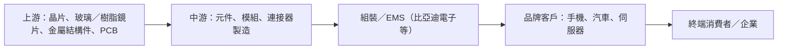

# 電子元件行業研究報告｜轉強觀察

- **更新日**：2026-10-20（Asia/Hong_Kong）
- **Dashboard 標籤**：轉強觀察（NEW）｜行業組「電子元件」（Electronic Components）｜成份股 0285.HK 比亞迪電子、2382.HK 舜宇光學科技（n=2）
- **技術備註**：技術數據截至 2026-10-20，由 HK Indices DB 提供，本報告未重算。n=2；組 5d +1.1%、20d −7.2%；5d 廣度 50%（+50 ppt），10d 廣度 0%。兩隻成份股 20d 仍為負，分別為比亞迪電子 −4.4%、舜宇 −10.1%，均帶持續弱及反彈標籤。
- **資料新鮮度**：公司數據以 2025 年報（2026-04）及 2026 中期業績／中期報告（2026-08 至 09）為主；行業統計至 2026 年 1–8 月（國家統計局 2026-09-27）；市值以 2026-10-20 收市計。截至本更新日未取得舜宇 2026 年 9 月出貨量公告。
- **非投資建議。**

---

## 1. 產業運作方式

**產業範圍。** 港股 Yahoo「電子元件」分類包括為手機、汽車、AI 伺服器等終端提供零組件、模組及代工組裝的公司。內地「計算機、通信和其他電子設備製造業」2026 年 1–8 月營業收入 128,102.9 億元（+20.1%），利潤總額 8,474.7 億元（+109.9%）（來源 1）。

**主要商業模式。**
1. **EMS／ODM 代工及組件**：比亞迪電子為品牌客戶提供手機、平板、新能源車電子及 AI 基建產品的製造服務，2026H1 收入 822.34 億元中組裝業務約 559.50 億元（來源 2、3）。
2. **光學元件及模組**：舜宇生產手機鏡頭／攝像模組及車載鏡頭，2026H1 手機相關收入 131.486 億元、汽車相關 37.62 億元（來源 4）。
3. **連接器及模組**：鴻騰精密（FIT Hon Teng）供應連接器、線纜及聲學產品，客戶包括鴻海（來源 5）。

**關鍵成功因素。** (i) 綁定大客戶的新品周期；(ii) 良率與規模；(iii) 向汽車、AI 伺服器等新應用延伸；(iv) 匯率與產能利用率管理。

---

## 2. 價值鏈分析

| 環節 | 特點 | 議價力 |
|---|---|---|
| 上游 | 晶片及材料 | 供應商分散度因公司而異（舜宇前五大 33.6%，來源 6） |
| 中游／EMS | 資本與工藝密集 | 客戶集中：比亞迪電子五大客戶組 85.11%（來源 7） |
| 品牌 | 掌握需求與規格 | 議價力最強 |

### 主要參與者（市值以 2026-10-20 收市計；HKD→USD 以 7.8476（TMA，2026-10-16，來源 15）換算）

#### (1) 比亞迪電子｜0285.HK｜Dashboard 成份股
- **簡介**：比亞迪集團旗下電子製造平台。2026H1 收入 822.34 億元（+2.02%），毛利 −27.18%，股東應佔溢利 4.26 億元（−75.35%）；新能源汽車業務 136.19 億元（+6.43%），AI 基建 7.53 億元（−10.57%），液冷板產品處量產爬坡階段（來源 2）。上半年匯兌損失 7.02 億元（來源 3）。
- **主要客戶與營收占比**：2025 年五大客戶組佔銷售約 85.11%，最大客戶組佔 55.45%（來源 7）。
- **主要供應商**：五大供應商佔採購約 59.4%，最大供應商佔 42.7%（來源 7）。
- **近 3 年營收與獲利**（人民幣億元；來源 8）

| 年度 | 2023 | 2024 | 2025 |
|---|---:|---:|---:|
| 收入 | 1,299.6 | 1,773.1（+36.4%） | 1,794.8（+1.2%） |
| 淨利潤 | 40.4 | 42.7（+5.6%） | 35.0（−17.9%） |

- **市值**：約 512.4 億港元 ≈ **65 億美元**（2026-10-20；來源 8）

#### (2) 舜宇光學科技｜2382.HK｜Dashboard 成份股
- **簡介**：光學鏡頭及模組龍頭。2026H1 手機相關收入 131.486 億元（−0.8%），汽車相關 37.62 億元（+10.6%）；中期報告引 IDC 稱上半年全球智能手機出貨約 5.67 億部（−5.3%）（來源 4）。
- **主要客戶與營收占比**：2025 年最大客戶佔收入約 11.3%（2024：15.8%），前五大佔約 45.1%（來源 6）。
- **主要供應商**：最大供應商佔採購約 16.2%，前五大佔約 33.6%（來源 6）。
- **近 3 年營收與獲利**（人民幣億元；來源 9）

| 年度 | 2023 | 2024 | 2025 |
|---|---:|---:|---:|
| 收入 | 316.8 | 382.9（+20.9%） | 432.3（+12.9%） |
| 淨利潤 | 11.0 | 27.0（+145.6%） | 46.4（+71.9%） |

- **市值**：約 648.7 億港元 ≈ **83 億美元**（2026-10-20；來源 9）

#### (3) 丘鈦科技｜1478.HK
- **簡介**：攝像頭模組及指紋識別模組製造商（同業比較，非 Dashboard 成份股）。
- **主要客戶與營收占比**：2025 年最大客戶佔營業額約 21.4%，五大客戶約 75.7%（來源 10）。
- **主要供應商**：最大供應商約 14.2%，五大供應商約 48.9%（來源 10）。
- **近 3 年營收與獲利**（人民幣億元；來源 11）

| 年度 | 2023 | 2024 | 2025 |
|---|---:|---:|---:|
| 收入 | 125.3 | 161.5（+28.9%） | 208.8（+29.3%） |
| 淨利潤 | 0.8 | 2.8（+240%） | 14.9（+435%） |

- **市值**：約 57.5 億港元 ≈ **7 億美元**（2026-10-20；來源 11）

#### (4) 鴻騰精密科技（FIT Hon Teng）｜6088.HK
- **簡介**：鴻海集團旗下連接器及線纜組件商（同業比較）。
- **主要客戶與營收占比**：2025 年前五大客戶佔收入 53.6%，最大客戶 32.0%；鴻海為前五大客戶之一（來源 5）。
- **主要供應商**：前五大供應商 22.5%，最大供應商 9.4%（來源 5）。
- **近 3 年營收與獲利**（美元百萬；來源 12）

| 年度 | 2023 | 2024 | 2025 |
|---|---:|---:|---:|
| 收入 | 4,196 | 4,451（+6.1%） | 5,003（+12.4%） |
| 淨利潤 | 129.0 | 153.7（+19.2%） | 156.1（+1.5%） |

- **市值**：約 284.7 億港元 ≈ **36 億美元**（2026-10-20；來源 12）

> 備註：瑞聲科技（2018.HK）業務相近，但 S&P／SA 將其歸入 Communication Equipment，故未列入本表。其 2025 年報顯示五大客戶佔收入約 72.5%、最大客戶 32.3%（來源 13）；市值約 416.2 億港元（2026-10-20，來源 14）。

---

## 3. 產業重要趨勢

1. **行業利潤高增但港股成份股承壓**：全國電子設備製造業 1–8 月利潤 +109.9%（來源 1），但比亞迪電子 H1 溢利 −75.35%（來源 2）。可見增長集中在其他子行業，屬推論。
2. **手機需求偏弱**：IDC 稱 H1 全球智能手機出貨 −5.3%（來源 4）。
3. **汽車電子成增長點**：舜宇汽車相關收入 +10.6%、比亞迪電子新能源車業務 +6.43%（來源 2、4）；但內地汽車 H1 國內銷量 −21.1%、出口 +65.3%（中汽協，經來源 3 引述）。
4. **AI 伺服器／液冷**：比亞迪電子液冷板處量產爬坡，但 AI 基建收入 H1 −10.57%（來源 2）。
5. **客戶集中度高**：比亞迪電子、丘鈦五大客戶佔 75%以上（來源 7、10）。

---

## 4. 未來 12 個月催化劑與風險

### 潛在正面
- **比亞迪電子 2026-10-29 董事會**審批第三季業績（HKEX 公告，來源 16）。
- **舜宇 2026 中期業績**（SA 估計 2026-11-26，來源 9；屬預計）／月度出貨公告。
- **AI 液冷及汽車電子放量**（來源 2）。

### 潛在負面
- **手機出貨下滑**（來源 4）。
- **比亞迪電子盈利及匯兌壓力**（來源 2、3）。
- **客戶集中**：最大客戶組佔 55.45%（來源 7）。
- **技術面**：兩成份股 20d 為負、10d 廣度 0%（Dashboard）。

---

## 5. 資料限制
- n=2，廣度只能取 0%、50% 或 100%，波動大。
- 舜宇 9 月出貨量及比亞迪電子第三季業績尚未取得。
- 國家統計局數據口徑為全國規模以上工業，不等同港股成份股。
- 3 年財務為 S&P Global MI 標準化口徑；舜宇 SA 估計日期屬預計，未經公司確認。
- 匯率使用 2026-10-16 TMA 數據。

## 6. 來源列表
| # | 機構／文件 | 日期 | URL |
|---|---|---|---|
| 1 | 國家統計局：2026年1—8月份全國規模以上工業企業利潤 | 2026-09-27 | https://www.stats.gov.cn/sj/zxfb/202609/t20260928_1965425.html |
| 2 | 比亞迪電子 2026 中期業績公告（HKEX） | 2026-08-28 | https://www.hkexnews.hk/listedco/listconews/sehk/2026/0828/2026082801218_c.pdf |
| 3 | 東方財富轉載研報：比亞迪電子 2026H1 點評 | 2026-08-30 | https://pdf.dfcfw.com/pdf/H3_AP202608301828745915_1.pdf |
| 4 | 舜宇光學科技 2026 中期報告（HKEX） | 2026-09-21 | https://www.hkexnews.hk/listedco/listconews/sehk/2026/0921/2026092100313.pdf |
| 5 | 鴻騰精密 2025 年度報告（HKEX） | 2026-04-30 | https://www1.hkexnews.hk/listedco/listconews/sehk/2026/0430/2026043002386_c.pdf |
| 6 | 舜宇光學科技 2025 年報（HKEX） | 2026-04-24 | https://www1.hkexnews.hk/listedco/listconews/sehk/2026/0424/2026042401984_c.pdf |
| 7 | 比亞迪電子 2025 年年報（HKEX） | 2026-04-22 | https://www1.hkexnews.hk/listedco/listconews/sehk/2026/0422/2026042200749_c.pdf |
| 8 | StockAnalysis：比亞迪電子財務／概覽 | 2026-10-20 | https://stockanalysis.com/quote/hkg/0285/financials/ |
| 9 | StockAnalysis：舜宇財務／概覽 | 2026-10-20 | https://stockanalysis.com/quote/hkg/2382/financials/ |
| 10 | 丘鈦科技 2025 年報（HKEX） | 2026-04-24 | https://www1.hkexnews.hk/listedco/listconews/sehk/2026/0424/2026042401327_c.pdf |
| 11 | StockAnalysis：丘鈦財務／概覽 | 2026-10-20 | https://stockanalysis.com/quote/hkg/1478/financials/ |
| 12 | StockAnalysis：鴻騰精密財務／概覽 | 2026-10-20 | https://stockanalysis.com/quote/hkg/6088/financials/ |
| 13 | 瑞聲科技 年報2025（HKEX） | 2026-04-27 | https://www1.hkexnews.hk/listedco/listconews/sehk/2026/0427/2026042701756_c.pdf |
| 14 | StockAnalysis：瑞聲科技概覽 | 2026-10-20 | https://stockanalysis.com/quote/hkg/2018/ |
| 15 | TMA USD/HKD 即期匯率 7.8476 | 2026-10-16 | https://www.tma.org.hk/（TMA 基準匯率頁） |
| 16 | 比亞迪電子 董事會會議日期公告（HKEX） | 2026-10-14 | https://www1.hkexnews.hk/listedco/listconews/sehk/2026/1014/2026101400634_c.pdf |
