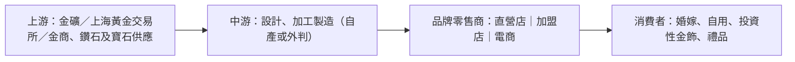

# 奢侈品（珠寶黃金）行業研究報告｜轉強觀察

- **更新日**：2026-10-20（Asia/Hong_Kong）
- **Dashboard 標籤**：轉強觀察（NEW）｜行業組「奢侈品」（Luxury Goods）｜成份股 1929.HK 周大福、6181.HK 老鋪黃金（n=2）
- **技術備註**：技術數據截至 2026-10-20，由 HK Indices DB 提供，本報告未重算。n=2；組 5d +2.3%、20d −8.7%；5d 廣度 50%（前值 0%，+50 ppt）。周大福 5d +5.1%，老鋪 20d −19.3% 且標籤為持續弱。
- **資料新鮮度**：公司數據以周大福 2026 財年年報（2026-06）及 FY27 Q1 經營數據（2026-07-23）、老鋪黃金 2026 中期業績（2026-08-25）為主；行業統計至 2026 年 1–9 月（國家統計局 2026-10-19）；市值以 2026-10-20 收市計。截至本更新日未見周大福 FY27 Q2（7–9 月）經營數據。
- **非投資建議。**

---

## 1. 產業運作方式

**產業範圍。** 港股 Yahoo「奢侈品」分類中的成份股以中國珠寶黃金零售商為主，產品包括計價黃金首飾（按金價加工費定價）、定價首飾（一口價黃金、鑲嵌、鑽石）及高端古法金器。內地「金銀珠寶類」限額以上零售額 2026 年 1–9 月為 2,620 億元，同比 −2.4%，9 月單月 −9.6%（來源 1）；同期社會消費品零售總額 +1.1%（來源 1）。

**主要商業模式。**
1. **加盟＋直營大眾珠寶**：周大福、周生生、六福以大規模門店網絡覆蓋內地及港澳，周大福約 69.4% 珠寶零售點為加盟店（來源 2）；收入來自零售、批發予加盟商及品牌服務費。
2. **自營高端古法金**：老鋪黃金以少量高端商場自營門店及線上渠道經營，2026H1 線下門店收入佔 77.8%、線上 22.2%（來源 3），定位與國際奢侈品客群重疊。
3. **原料以黃金為主**：黃金採購集中於上海黃金交易所會員或金商，供應商高度集中（老鋪前五大供應商佔 91.4%，來源 4；周大福前五大佔 90.3%，來源 5）。

**關鍵成功因素。** (i) 品牌與產品設計（定價產品提升毛利）；(ii) 金價管理（存貨成本、套期保值、調價時點）；(iii) 渠道效率（關閉低效門店、拓展港澳及海外）；(iv) 旅客與高端消費景氣。

---

## 2. 價值鏈分析

| 環節 | 特點 | 議價力 |
|---|---|---|
| 上游 | 黃金為標準化商品，價格由國際金價決定 | 供應商集中但價格透明（來源 4、5） |
| 中游 | 工藝與設計決定溢價 | 古法金／定價首飾毛利較高（來源 3） |
| 零售 | 客戶極分散 | 各公司五大客戶均 <30%（來源 4、5、6） |

### 主要參與者（市值以 2026-10-20 收市計；HKD→USD 以 7.8476（TMA，2026-10-16，來源 15）換算）

#### (1) 周大福珠寶｜1929.HK｜Dashboard 成份股
- **簡介**：大中華最大珠寶零售商之一，財年截至 3 月。FY27 Q1（2026年4–6月）集團零售值 +15.1%，內地直營同店 +19.6%、港澳同店 +41.7%；內地定價首飾同店 −1.0%，計價黃金首飾同店 +38.0%；季內內地淨減少 258 個零售點（來源 2）。
- **主要客戶與營收占比**：2026 財年五大客戶佔營業額少於 30%（來源 5）。
- **主要供應商**：五大供應商佔採購 90.3%，最大供應商佔 75.1%（來源 5）。
- **近 3 年營收與獲利**（港元億元；財年截至 3 月；來源 7）

| 財年 | FY2024 | FY2025 | FY2026 |
|---|---:|---:|---:|
| 營業額 | 1,087.1 | 896.6（−17.5%） | 944.0（+5.3%） |
| 淨利潤 | 65.0 | 59.2（−9.0%） | 90.0（+52.2%） |

- **市值**：約 1,111.9 億港元 ≈ **142 億美元**（2026-10-20；來源 8）

#### (2) 老鋪黃金｜6181.HK｜Dashboard 成份股
- **簡介**：高端古法手工金器品牌，全部自營。2026H1 銷售業績約 227.79 億元（+60.6%）、收入 198.08 億元（+60.3%）、期內利潤 42.67 億元（+88.2%）；毛利率 41.3%（+3.2 ppt），境外收入 +107.8%（來源 3）。媒體點評指截至 2026H1 末有 45 家自營門店（來源 9）。
- **主要客戶與營收占比**：2025 年前五大客戶佔銷售 30% 以下（來源 4）。
- **主要供應商**：前五大供應商佔採購 91.4%，最大供應商北京工美集團佔 55.3%（來源 4）。
- **近 3 年營收與獲利**（人民幣億元；來源 10）

| 年度 | 2023 | 2024 | 2025 |
|---|---:|---:|---:|
| 收入 | 31.8 | 85.1（+167.5%） | 273.0（+221.0%） |
| 淨利潤 | 4.2 | 14.7（+253.8%） | 48.7（+230.5%） |

- **市值**：約 546.1 億港元 ≈ **70 億美元**（2026-10-20；SA 以 1.77 億股計；來源 11）

#### (3) 周生生集團｜0116.HK
- **簡介**：港澳及內地珠寶鐘錶零售商，兼營貴金屬批發（業務描述見來源 6）。
- **主要客戶與營收占比**：五大客戶佔銷售少於 30%（來源 6）。
- **主要供應商**：五大供應商佔採購 74%，最大供應商佔 53%（來源 6）。
- **近 3 年營收與獲利**（港元億元；來源 12）

| 年度 | 2023 | 2024 | 2025 |
|---|---:|---:|---:|
| 收入 | 250.1 | 211.8（−15.3%） | 224.5（+6.0%） |
| 淨利潤 | 10.1 | 8.1（−20.5%） | 17.2（+113.2%） |

- **市值**：約 88.5 億港元 ≈ **11 億美元**（2026-10-20；來源 12）

#### (4) 六福集團｜0590.HK
- **簡介**：港澳及內地珠寶零售及品牌授權商，財年截至 3 月（來源 14）。
- **主要客戶與營收占比**：五名最大客戶收入佔比合計少於 30%（來源 14）。
- **主要供應商**：公開資訊有限（年報數字排版本報告未能可靠解讀）。
- **近 3 年營收與獲利**（港元億元；財年截至 3 月；來源 13）

| 財年 | FY2024 | FY2025 | FY2026 |
|---|---:|---:|---:|
| 收入 | 153.3 | 133.4（−13.0%） | 172.1（+29.0%） |
| 淨利潤 | 17.7 | 11.0（−37.7%） | 20.5（+86.0%） |

- **市值**：約 129.0 億港元 ≈ **16 億美元**（2026-10-20；來源 13）

---

## 3. 產業重要趨勢

1. **整體金飾零售疲弱但龍頭分化**：金銀珠寶類零售額 1–9 月 −2.4%、9 月 −9.6%（來源 1），而周大福 FY27 Q1 零售值 +15.1%、老鋪 H1 收入 +60.3%（來源 2、3）。
2. **計價黃金回暖、定價首飾受壓**：周大福計價黃金同店 +38.0% 對比定價首飾 −1.0%（來源 2）；媒體指金價 2026 上半年回落釋放需求（來源 16）。
3. **港澳市場強於內地**：周大福港澳同店 +41.7%（來源 2）。
4. **門店網絡優化**：周大福季內內地淨關店 258 個（來源 2）。
5. **高端化與出海**：老鋪境外收入 +107.8%（來源 3）。

---

## 4. 未來 12 個月催化劑與風險

### 潛在正面
- **周大福 FY27 中期業績**（SA 估計 2026-11-25，來源 8）若確認毛利率與同店改善，或支撐轉強。
- **金價回落後的需求釋放**延續（來源 16）。
- **港澳旅客消費**持續強勁（來源 2）。

### 潛在負面
- **金價急升**壓抑計價黃金銷量、急跌引致存貨價值波動（推論）。
- **內地珠寶零售下滑**：9 月金銀珠寶類 −9.6%（來源 1）。
- **老鋪高基數與技術弱勢**：20d −19.3%，持續弱標籤（Dashboard）。
- **供應集中**：周大福最大供應商佔 75.1%、老鋪 55.3%（來源 4、5）。

---

## 5. 資料限制
- Yahoo「奢侈品」分類在港股以珠寶商為主，非歐洲奢侈品牌口徑。
- 周大福與六福財年截至 3 月，與曆年制公司不可直接比較。
- 金價變動引用媒體報道，未取得官方金價序列。
- 老鋪市值依 SA 股數，或未反映全部股本。
- 匯率使用 2026-10-16 TMA 數據，未更新至 10-20。
- 3 年財務為 S&P Global MI 標準化口徑。

## 6. 來源列表
| # | 機構／文件 | 日期 | URL |
|---|---|---|---|
| 1 | 國家統計局：2026年1—9月份社會消費品零售總額 | 2026-10-19 | https://www.stats.gov.cn/sj/zxfb/202610/t20261019_1965614.html |
| 2 | 周大福 截至2026年6月30日止三個月經營數據（HKEX） | 2026-07-23 | https://www1.hkexnews.hk/listedco/listconews/sehk/2026/0723/2026072300309_c.pdf |
| 3 | 老鋪黃金 2026 中期業績公告 | 2026-08-25 | https://hk.lphj.com/ir/2026/0825/2026082500347_c.pdf |
| 4 | 老鋪黃金 2025 年度報告（HKEX） | 2026-04-16 | https://www1.hkexnews.hk/listedco/listconews/sehk/2026/0416/2026041600465_c.pdf |
| 5 | 周大福 2026 年報（HKEX） | 2026-06-18 | https://www1.hkexnews.hk/listedco/listconews/sehk/2026/0618/2026061800002_c.pdf |
| 6 | 周生生 2025 年報（HKEX） | 2026-04-24 | https://www1.hkexnews.hk/listedco/listconews/sehk/2026/0424/2026042402287_c.pdf |
| 7 | StockAnalysis：周大福財務摘要（S&P Global MI） | 2026-10-20 查閱 | https://stockanalysis.com/quote/hkg/1929/financials/ |
| 8 | StockAnalysis：周大福概覽（市值、預估業績日） | 2026-10-20 | https://stockanalysis.com/quote/hkg/1929/ |
| 9 | 格隆匯：老鋪黃金 2026 中報點評 | 2026-08 | https://www.gelonghui.com/news/5306653 |
| 10 | StockAnalysis：老鋪黃金財務摘要 | 2026-10-20 查閱 | https://stockanalysis.com/quote/hkg/6181/financials/ |
| 11 | StockAnalysis：老鋪黃金概覽 | 2026-10-20 | https://stockanalysis.com/quote/hkg/6181/ |
| 12 | StockAnalysis：周生生財務摘要／概覽 | 2026-10-20 | https://stockanalysis.com/quote/hkg/0116/financials/ |
| 13 | StockAnalysis：六福財務摘要／概覽 | 2026-10-20 | https://stockanalysis.com/quote/hkg/0590/financials/ |
| 14 | 六福集團 2025/26 年報（HKEX） | 2026-07-24 | https://www1.hkexnews.hk/listedco/listconews/sehk/2026/0724/2026072401449_c.pdf |
| 15 | TMA USD/HKD 即期匯率 7.8476 | 2026-10-16 | https://www.tma.org.hk/（TMA 基準匯率頁） |
| 16 | 華爾街見聞：金價回落釋放需求，周大福增長重新向計價黃金傾斜 | 2026-07-23 | https://wallstreetcn.com/articles/3777850 |
