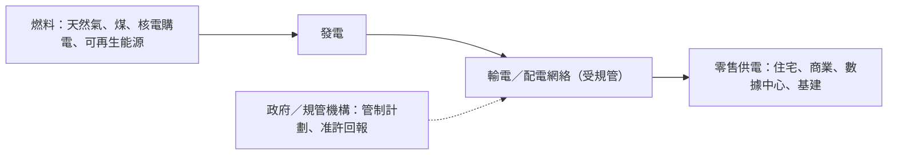

# 受規管電力公用行業研究報告｜轉弱觀察

- **更新日**：2026-10-20（Asia/Hong_Kong）
- **Dashboard 標籤**：轉弱觀察｜行業組「受規管電力公用」（Utilities - Regulated Electric）｜成份股 0002.HK 中電控股、1038.HK 長江基建（n=2）；所屬細分「公用事業」（Utilities，n=6）
- **技術備註**：技術數據截至 2026-10-20，由 HK Indices DB 提供，本報告未重算。
  - 本組：5d −0.4%、20d +0.7%；5d 廣度 50%（前值 100%，−50 ppt），10d 廣度 100%。
  - 細分公用事業：5d −0.7%、20d +0.9%；5d 廣度 33.3%（前值 83.3%）。
  - 長江基建標籤為持續強；中電 20d −1.3%。
- **相關報告**：獨立電力 `independent-power-producers.md`（電能實業、華潤電力等）。
- **資料新鮮度**：
  - 公司數據：2025 年報（2026-04）、2026 中期業績（2026-08）、中電第三季營運簡報（2026-10-12）。
  - 市值：2026-10-20 收市。
- **非投資建議。**

---

## 1. 產業運作方式

**產業範圍。** 這是受政府管制回報的電網及縱向一體化電力公司。香港兩家電力公司按《管制計劃協議》經營，回報與固定資產掛鈎；長江基建則持有英、澳、加等地的受規管電網、燃氣及水務資產（來源 1、2、5）。

**主要商業模式。**
1. **香港縱向一體化供電**：中電負責九龍、新界供電；港燈負責港島及南丫島供電。電費包括基本電費及燃料調整費，中電 10 月平均淨電價較 1 月 +4.8%（來源 1）。
2. **海外受規管資產組合**：長江基建以聯營／合營方式持有資產，綜合收入低估業務規模；2026H1 出售 UKPN／英國鐵路資產帶來一次性收益，股東應佔溢利 212.52 億港元（+389%）（來源 2）。
3. **內地及海外發電**：中電另有內地核電、可再生能源及澳洲 EnergyAustralia 業務（來源 1、3）。

**關鍵成功因素。** (i) 規管回報率與資產基礎增長；(ii) 利率（影響估值和融資成本）；(iii) 電力需求（例如數據中心）；(iv) 燃料成本轉嫁機制。

---

## 2. 價值鏈分析

| 環節 | 特點 | 議價力 |
|---|---|---|
| 燃料 | 價格波動由燃料調整費轉嫁 | 中性（來源 1） |
| 網絡 | 自然壟斷、受規管回報 | 回報由規管決定 |
| 用戶 | 極分散 | 長江基建前五大客戶 <30%（來源 6） |

### 主要參與者（市值以 2026-10-20 收市計；HKD→USD 以 7.8476（TMA，2026-10-16，來源 11）換算）

#### (1) 中電控股｜0002.HK｜Dashboard 成份股
- **簡介**：香港最大電力公司。
  - 2026 年首三季香港售電 +2.5% 至 28,131 GWh；數據中心用電 +12.8%，佔 6.6%（來源 1）。
  - 2026H1 營運盈利 57.33 億港元（+9.7%），總盈利 59.97 億港元（+6.6%）（來源 3）。
  - 9 月山東風電 300MW 及 125MW 投產（來源 1）。
- **主要客戶與營收占比**：公開資訊有限。用戶為住宅、商業及基建等，首三季商業用電 +4.3%、住宅 −1.4%（來源 1）。
- **主要供應商**：公開資訊有限。
- **近 3 年營收與獲利**（港元億元；來源 4）

| 年度 | 2023 | 2024 | 2025 |
|---|---:|---:|---:|
| 收入 | 871.7 | 909.6（+4.3%） | 880.2（−3.2%） |
| 淨利潤 | 66.5 | 117.4（+76.5%） | 104.7（−10.8%） |

- **市值**：約 1,931.5 億港元 ≈ **246 億美元**（2026-10-20；來源 4）

#### (2) 長江基建集團｜1038.HK｜Dashboard 成份股
- **簡介**：環球基建投資者，持有受規管電網、燃氣、水務等資產。
  - 2026H1 溢利 212.52 億港元（+389%），主要來自出售 UKPN／UK Rails；中期息 0.75 港元（+2.7%）（來源 2）。
  - 母公司長和披露基建分部本地貨幣基礎 EBITDA／EBIT −9%／−12%（來源 5）。
- **主要客戶與營收占比**：前五大客戶佔收入不足 30%（來源 6）。
- **主要供應商**：前五大供應商佔採購不足 30%（來源 6）。
- **近 3 年營收與獲利**（港元億元；綜合收入不含聯營／合營；來源 7）

| 年度 | 2023 | 2024 | 2025 |
|---|---:|---:|---:|
| 收入 | 67.7 | 55.4（−18.2%） | 47.8（−13.8%） |
| 淨利潤 | 80.3 | 81.2（+1.1%） | 82.7（+1.8%） |

- **市值**：約 1,691.9 億港元 ≈ **216 億美元**（2026-10-20；來源 7）

#### (3) 港燈電力投資｜2638.HK
- **簡介**：港島及南丫島受規管供電商（同業比較，非 Dashboard 成份股）。
- **主要客戶與營收占比**：公開資訊有限。
- **主要供應商**：公開資訊有限。
- **近 3 年營收與獲利**（港元億元；來源 8）

| 年度 | 2023 | 2024 | 2025 |
|---|---:|---:|---:|
| 收入 | 114.1 | 120.6（+5.7%） | 121.3（+0.6%） |
| 淨利潤 | 31.6 | 31.1（−1.4%） | 31.5（+1.2%） |

- **市值**：約 550.5 億港元 ≈ **70 億美元**（2026-10-20；來源 8）

#### (4) 電能實業｜0006.HK（參考）
- 在 Dashboard 歸類為獨立電力，持有港燈權益及海外受規管資產，詳見 `independent-power-producers.md`。市值約 1,285.1 億港元 ≈ **164 億美元**（2026-10-20；來源 9）。

---

## 3. 產業重要趨勢

1. **數據中心帶動用電**：中電數據中心用電 +12.8%，沙嶺數據園供電目標 2027 年中（來源 1）。
2. **電價上調壓力**：中電 10 月平均淨電價較 1 月 +4.8%，同時有燃料回扣（來源 1）。
3. **資產回收與再投資**：長江基建出售英國資產，盈利一次性大增（來源 2），但基建分部本地貨幣基礎 EBITDA 下降（來源 5）。
4. **內地核電電價下調**：中電陽江核電電價下降，內地可再生能源發電量溫和上升（來源 1）。
5. **防守板塊輪動**：細分 5d 廣度由 83.3% 跌至 33.3%（Dashboard）。

---

## 4. 未來 12 個月催化劑與風險

### 潛在正面
- **中電第三期中期股息**（來源 10）。
- **港燈 2026-11-11、長江基建 2026-11-12 預計業務更新**（SA 估計，屬預計；來源 7、8）。
- **數據中心及新能源項目投產**（來源 1）。

### 潛在負面
- **利率上升**削弱防守股估值（推論）。
- **一次性收益消退**：長江基建 2026H1 溢利含出售收益（來源 2）。
- **規管及電價政治壓力**：電價上調（來源 1）。
- **技術面轉弱**：5d 廣度由 100% 降至 50%（Dashboard）。

---

## 5. 資料限制
- 成份股 n=2，廣度波動大。
- 長江基建綜合收入不含聯營／合營，低估業務規模。
- 港燈及中電供應商資料未在年報抽取中找到，標為公開資訊有限。
- SA 日期屬估計；中電 3 年財務來自先前 SA 抓取資料。
- 匯率使用 2026-10-16 TMA 數據。

## 6. 來源列表
| # | 機構／文件 | 日期 | URL |
|---|---|---|---|
| 1 | 中電控股 2026 年第三季營運簡報（HKEX） | 2026-10-12 | https://www1.hkexnews.hk/listedco/listconews/sehk/2026/1012/2026101200582_c.pdf |
| 2 | 長江基建 2026 中期業績（HKEX） | 2026-08-12 | https://www1.hkexnews.hk/listedco/listconews/sehk/2026/0812/2026081200400.pdf |
| 3 | 中電控股 2026 中期業績（HKEX） | 2026-08-06 | https://www1.hkexnews.hk/listedco/listconews/sehk/2026/0806/2026080600236_c.pdf |
| 4 | StockAnalysis：中電財務／概覽 | 2026-10-20 | https://stockanalysis.com/quote/hkg/0002/financials/ |
| 5 | 長和 2026 中期業績（HKEX） | 2026-08-27 | https://www1.hkexnews.hk/listedco/listconews/sehk/2026/0827/2026082700399_c.pdf |
| 6 | 長江基建 二零二五年年報（HKEX） | 2026-04-16 | https://www1.hkexnews.hk/listedco/listconews/sehk/2026/0416/2026041600954_c.pdf |
| 7 | StockAnalysis：長江基建財務／概覽 | 2026-10-20 | https://stockanalysis.com/quote/hkg/1038/financials/ |
| 8 | StockAnalysis：港燈財務／概覽 | 2026-10-20 | https://stockanalysis.com/quote/hkg/2638/financials/ |
| 9 | StockAnalysis：電能實業概覽 | 2026-10-20 | https://stockanalysis.com/quote/hkg/0006/ |
| 10 | 中電控股 第三期中期股息公告（HKEX） | 2026-10-12 | https://www1.hkexnews.hk/listedco/listconews/sehk/2026/1012/2026101200584_c.pdf |
| 11 | TMA USD/HKD 即期匯率 7.8476 | 2026-10-16 | https://www.tma.org.hk/（TMA 基準匯率頁） |
| 12 | 港燈電力投資 2025 年年報（HKEX） | 2026-04-20 | https://www1.hkexnews.hk/listedco/listconews/sehk/2026/0420/2026042000870_c.pdf |
