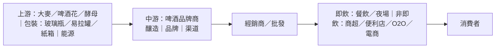

# 啤酒飲料行業研究報告｜轉弱觀察

- **更新日**：2026-10-21（Asia/Hong_Kong）
- **Dashboard 標籤**：轉弱觀察｜行業組「啤酒飲料」（Beverages - Brewers）｜成份股 0291.HK 華潤啤酒、1876.HK 百威亞太（n=2）
- **技術備註**：技術數據截至 2026-10-21，由 HK Indices DB 提供，本報告未重算。
  - 本組：5d −0.15%、20d +0.68%；5d 廣度 50%（前值 100%，−50 ppt），10d 廣度 100%。
  - 華潤啤酒標籤超強勢（但 1d −2.82%、5d −2.52%）；百威亞太 5d +2.23%、20d −1.08%。
- **資料新鮮度**：
  - 公司數據：2025 年報（2026-03／04）、2026 中期業績（華潤 2026-08-19、百威 2026-07-30）；同業青島／燕京／重慶 2026 中期（2026-08）。
  - 行業統計：酒、飲料和精製茶製造業至 2026 年 1–8 月（國家統計局 2026-09-28）。
  - 市值：DB `stocks.market_cap`（資訊約 2026-10-18）按 2026-10-21 收市價比例調整，HKD→USD 以約 7.8478（此為估計）。
- **非投資建議。**

---

## 1. 產業運作方式

**產業範圍。** 中國及亞太啤酒產業覆蓋大眾、中檔、高端／超高端啤酒及部分無醇／低醇創新。國家統計局「酒、飲料和精製茶製造業」2026 年 1–8 月營業收入 9,018.2 億元（−7.7%）、利潤總額 1,431.0 億元（−34.7%）（來源 1）；該口徑含白酒，跌幅不宜直接等同啤酒，但反映酒類消費整體承壓。

**主要商業模式。**
1. **高端化＋產品結構升級**：以次高檔／高檔及以上產品提升噸價與毛利。華潤啤酒 2026H1 次高及以上銷量增幅逾 10%，佔比升至逾 26%；喜力銷量逾 +20%（來源 2）。
2. **品牌矩陣＋渠道雙輪**：本土龍頭（雪花等）覆蓋縣域與餐飲；國際高端組合（百威、科羅娜、時代等）側重夜場／即飲與新興 O2O。百威亞太強調非即飲與 O2O 擴張以對沖即飲疲弱（來源 3）。
3. **區域產能＋經銷網絡**：啤酒運輸半徑短，產能貼近市場；多層經銷與即飲（on-trade）／非即飲（off-trade）結構決定量價。
4. **第二曲線嘗試**：華潤啤酒布局白酒（景芝等），惟 2026H1 白酒收入僅 5.70 億元、盈利貢獻有限（來源 2）。

**關鍵成功因素。** (i) 高端化執行與噸價；(ii) 即飲／餐飲場景修復；(iii) 成本（大麥、包裝、能源）；(iv) 渠道費用投放效率；(v) 區域競爭格局穩定性。

**當前週期。** 行業由「增量擴張」轉入「結構升級＋存量競爭」。華潤啤酒量價穩中有升，百威亞太中國即飲明顯承壓、韓國／印度對沖；同業青島啤酒 2026H1 營收／銷量雙降（來源 4）。

---

## 2. 價值鏈分析

| 環節 | 特點 | 議價力 |
|---|---|---|
| 上游農產品／包裝 | 大宗商品屬性，價格隨供需與匯率波動 | 龍頭可規模採購部分對沖（公開資訊有限） |
| 中游品牌商 | 品牌與渠道決定噸價 | 高端品牌毛利率顯著高於大眾（百威亞太 2026H1 毛利率約 51.9%，來源 3） |
| 渠道 | 即飲景氣與費用投放高度相關 | 客戶分散；年報多披露前五大客戶佔比不足 30%（公開資訊有限，來源 5） |

### 主要參與者（市值以 2026-10-21 估計；HKD→USD ≈7.8478）

#### (1) 華潤啤酒｜0291.HK｜Dashboard 成份股
- **簡介**：中國啤酒銷量龍頭之一，「雪花」為核心，並經營喜力等國際品牌；另有白酒業務。2026H1 營業額 242.40 億元（+1.2%），股東應佔溢利 51.69 億元（−10.7%）；啤酒銷量約 660 萬千升（+1.7%）、啤酒收入 236.70 億元（+2.2%）（來源 2）。2025 年營業額 379.85 億元、股東應佔溢利 33.71 億元（來源 6）。
- **主要客戶與營收占比**：公開資訊有限；啤酒客戶高度分散。
- **主要供應商**：公開資訊有限（大麥、包裝材料等）。
- **近 3 年營收與獲利**（人民幣億元；來源 6）

| 年度 | 2023 | 2024 | 2025 |
|---|---:|---:|---:|
| 營業額 | 389.32 | 386.35（−0.8%） | 379.85（−1.7%） |
| 股東應佔溢利 | 51.53 | 47.39（−8.0%） | 33.71（−28.9%） |

- **市值**：約 614 億港元 ≈ **78 億美元**（2026-10-21 估計；來源 7）

#### (2) 百威亞太｜1876.HK｜Dashboard 成份股
- **簡介**：亞太高端啤酒龍頭，品牌組合含百威、科羅娜、時代、哈爾濱、凱獅等；主要市場中國、韓國、印度。2026H1 收入 31.71 億美元（內生 −1.4%），正常化 EBITDA 9.26 億美元（−8.9%），股權持有人應佔溢利 4.73 億美元；中國銷量／收入 −6.0%／−6.4%（來源 3）。2025 年收入 57.64 億美元、應佔溢利 4.89 億美元（來源 8）。
- **主要客戶與營收占比**：公開資訊有限；經銷與零售網絡分散。
- **主要供應商**：公開資訊有限；強調與農戶及包裝供應商合作（來源 8）。
- **近 3 年營收與獲利**（百萬美元；來源 8、9）

| 年度 | 2023 | 2024 | 2025 |
|---|---:|---:|---:|
| 收入 | 6,856 | 6,246（−8.9% 呈報） | 5,764（內生 −6.1%） |
| 應佔溢利 | 852 | 726（−14.8%） | 489（−32.6%） |

- **市值**：約 789 億港元 ≈ **101 億美元**（2026-10-21 估計；來源 7）

#### (3) 青島啤酒｜0168.HK／600600.SH
- **簡介**：全國性啤酒品牌。2026H1 營收約 196.55 億元（−4.08%），歸母淨利約 39.20 億元（+0.40%），銷量約 450 萬千升（−4.90%）（來源 4）。
- **主要客戶／供應商**：公開資訊有限（本報告未逐項核對年報集中度原文）。
- **市值**：公開資訊有限（HSI 成份 DB 未收錄完整市值欄，此處不虛構）。

#### (4) 燕京啤酒｜000729.SZ
- **簡介**：華北為主的區域＋全國品牌。2026H1 營收約 90.31 億元（+5.53%），歸母淨利約 13.99 億元（+26.86%），銷量約 242.69 萬千升（+3.20%）（來源 10）。
- **市值**：A 股口徑，本報告不換算港元（公開資訊有限）。

#### (5) 重慶啤酒｜600132.SH（嘉士伯中國平台）
- **簡介**：嘉士伯體系在華上市平台。2026H1 營收約 85.76 億元（−2.98%），歸母淨利約 7.96 億元（−7.98%）（來源 11）。
- **市值**：A 股口徑，不換算。

#### (6)–(7) 珠江啤酒、其他區域酒企
- **簡介**：華南等區域市場參與者；百威亞太年報披露持有珠江啤酒相關權益（來源 8）。公開財務細節本報告未逐家展開。

---

## 3. 產業重要趨勢

1. **高端化仍是主線，但速度分化**：華潤次高及以上雙位數增長（來源 2）；百威中國 tonnage 與收入仍跌，依賴品牌組合與非即飲（來源 3）。
2. **即飲疲弱、非即飲／O2O 加碼**：百威明確指出即飲不振與天氣因素拖累 Q2 中國表現，並加大非即飲與 O2O（來源 3）。
3. **區域對沖**：韓國、印度成為百威亞太盈利穩定器（來源 3、8）。
4. **行業利潤統計失真風險**：酒飲料精製茶利潤 −34.7% 主要受白酒拖累，解讀啤酒需交叉公司報表（來源 1）。
5. **白酒第二曲線尚早**：華潤白酒收入體量小、盈利低於去年同期（來源 2）。

---

## 4. 未來 12 個月催化劑與風險

### 催化劑
1. **百威亞太九個月業績（2026-10-28／29）**：驗證中國即飲是否企穩、韓國／印度動能能否延續（來源 12）。
2. **國家統計局 1–9 月工業利潤（2026-10-27）**：觀察酒飲料利潤跌幅是否收窄（來源 13）。
3. **華潤啤酒高端單品與旺季執行**：次高檔新品與喜力放量若延續，支撐噸價（來源 2）。
4. **成本端（大麥／鋁罐）回落空間**：若商品價格回落，毛利率有修復彈性（公開資訊有限，此為推論）。

### 風險
1. **餐飲／夜場復甦低於預期**：直接打擊即飲量與費用效率（來源 3）。
2. **價格戰與渠道費用抬升**：存量競爭下促銷加劇，侵蝕高端化紅利（推論，參見同業量價走弱，來源 4）。
3. **白酒減值與合營波動**：華潤 2025 年溢利已受白酒相關項目影響，後續仍可能擾動報表（來源 6）。
4. **宏觀消費與天氣**：百威已披露不利天氣衝擊（來源 3）。

---

## 來源

1. 國家統計局：1—8月規模以上工業企業利潤，2026-09-28｜https://www.stats.gov.cn/sj/zxfb/202609/t20260928_1965425.html  
2. 華潤啤酒 2026 中期業績（HKEX），2026-08-19｜https://www.hkexnews.hk/listedco/listconews/sehk/2026/0819/2026081900246_c.pdf  
3. 百威亞太 2026 中期業績（HKEX），2026-07-30｜https://www1.hkexnews.hk/listedco/listconews/sehk/2026/0730/2026073000052_c.pdf  
4. 青島啤酒 2026 半年度報告（巨潮），2026-08-27｜https://static.cninfo.com.cn/finalpage/2026-08-27/1225514143.PDF  
5. 行業慣例／年報集中度披露（公開資訊有限）  
6. 華潤啤酒 2025 末期業績／年報，2026-03-23／2026-04-23｜https://www.hkexnews.hk/listedco/listconews/sehk/2026/0323/2026032300266_c.pdf；https://www.hkexnews.hk/listedco/listconews/sehk/2026/0423/2026042300830.pdf  
7. HK Indices DB `stocks.market_cap`（約 2026-10-18）× 價格比例至 2026-10-21；USD/HKD≈7.8478（此為估計）  
8. 百威亞太 2025 年報，2026-03-23｜https://www.hkexnews.hk/listedco/listconews/sehk/2026/0323/2026032300073.pdf  
9. 百威亞太 2024／2023 業績公開彙總（年報），2024–2025｜https://www.hkexnews.hk/listedco/listconews/sehk/2025/0416/2025041600363.pdf 等  
10. 燕京啤酒 2026 半年度報告，2026-08｜https://static.cninfo.com.cn/finalpage/2026-08-21/1225487240.PDF  
11. 重慶啤酒 2026 半年度報告，2026-08｜https://carlsbergchina.com.cn/media/astnhiwa/%E9%87%8D%E5%BA%86%E5%95%A4%E9%85%922026%E5%B9%B4%E5%8D%8A%E5%B9%B4%E6%8A%A5.pdf  
12. 百威亞太董事會／業績相關公告，2026-10-04｜https://www.hkexnews.hk/listedco/listconews/sehk/2026/1004/2026100400022_c.pdf  
13. 國家統計局：2026年主要統計信息發布日程表｜https://www.stats.gov.cn/xw/tjxw/tzgg/202512/t20251224_1962137.html  

**非投資建議。**
