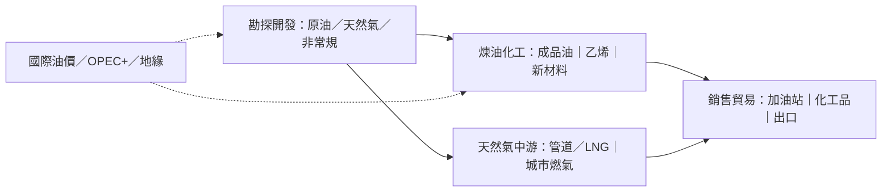

# 綜合石油天然氣行業研究報告｜轉弱觀察

- **更新日**：2026-10-21（Asia/Hong_Kong）
- **Dashboard 標籤**：轉弱觀察｜行業組「綜合石油天然氣」（Oil & Gas Integrated）｜成份股 0386.HK 中石化、0857.HK 中石油（n=2）
- **技術備註**：技術數據截至 2026-10-21，由 HK Indices DB 提供，本報告未重算。
  - 本組：5d −2.37%、20d +1.64%；5d 廣度 0%（前值 50%，−50 ppt），10d 廣度 100%。
  - 中石油標籤持續強（但 5d −4.31%）；中石化 5d −0.44%。
- **相關**：同業中海油（0883.HK）屬 Oil & Gas E&P，非本組成份，僅作比較。
- **資料新鮮度**：
  - 公司：2025 年報（2026-03）、2026 中期（2026-08）；三季報董事會通告（中石油 10-28、中石化 10-29）。
  - 油價：公開市場報價約 2026-10（Brent 約 107–110 美元／桶量級）。
  - 市值：DB `stocks.market_cap`（約 2026-10-18）按 10-21 收市比例調整；港股成份口徑，A+H 總市值另計（此為估計）。
- **非投資建議。**

---

## 1. 產業運作方式

**產業範圍。** 綜合石油天然氣公司從事原油與天然氣勘探開發（上游）、煉油與化工（中游）、成品油與天然氣銷售／貿易（下游）的一體化經營。中國「三桶油」中，中石油偏上游與天然氣管道優勢，中石化偏煉化與銷售網絡，中海油偏海上勘探生產（來源 1、2、3）。

**主要商業模式。**
1. **上游：量價驅動**：盈利與實現油價、天然氣量價及操作成本掛鈎。中石油 2026H1 歸母淨利約 +22%，主因油氣及化工產品價格與銷量變化（來源 1）。
2. **中游煉化：裂解價差與裝置負荷**：原油成本與成品油／化工品價格之差決定煉化利潤；高油價時期下游往往承壓，需「減油增化」、拓出口（來源 2）。
3. **下游銷售與天然氣全產業鏈**：成品油零售網絡、非油品、充電／LNG／氫能等新業態；天然氣產運銷一體化平滑波動（來源 1、2）。
4. **資本開支與分紅**：高自由現金流階段提高派息與回購；中石化 2026H1 中期派息率約 49.5%，並連續多年回購（來源 2）。

**關鍵成功因素。** (i) 油氣實現價格；(ii) 儲量接替與產量；(iii) 煉化價差與產品結構；(iv) 天然氣成本與銷售結構；(v) 資本紀律與股東回報。

**當前週期。** 2026 年上半年油氣價格偏強帶動上游盈利高增；10 月 Brent 期貨公開報價仍處相對高位（約 107–110 美元／桶，來源 4）。技術上本組成份出現高位 5d 廣度歸零，反映短線回吐。

---

## 2. 價值鏈分析

| 環節 | 特點 | 議價力 |
|---|---|---|
| 國際原油 | 美元計價商品，受 OPEC+、地緣、庫存影響 | 公司為價格接受者 |
| 上游生產 | 資源與技術壁壘高 | 中石油、中海油資源優勢明顯（來源 1、3） |
| 煉化 | 產能過剩與新能源替代壓抑成品油 | 一體化公司可內部優化，但仍受價差約束（來源 2） |
| 終端銷售 | 網絡密、競爭強 | 份額相對穩定，非油與新能源補充（來源 2） |

### 主要參與者（市值 2026-10-21 估計；HKD→USD≈7.8478；港股 DB 口徑）

#### (1) 中國石油｜0857.HK／601857.SH｜Dashboard 成份股
- **簡介**：中國最大油氣生產與銷售商之一。2026H1 營業收入約 15,274.91 億元（+5.3%），歸母淨利約 1,039.36 億元（+22.0%）；原油產量 462.9 百萬桶（−2.8%），可銷售天然氣 2,746.1 十億立方英尺（+2.3%）；成品油產量 −8.8%（來源 1）。中期息每股 0.26 元。
- **主要客戶與營收占比**：公開資訊有限；下游用戶與貿易對手高度分散。
- **主要供應商**：公開資訊有限；部分原油進口與油服採購。
- **近 3 年營收與獲利**（人民幣億元；公開彙總／年報，來源 5；同比為約數）

| 年度 | 2023 | 2024 | 2025 |
|---|---:|---:|---:|
| 營業收入 | 約 30,130 | 約 29,380 | 約 28,640 |
| 歸母淨利潤 | 約 1,614 | 約 1,647 | 約 1,573 |

- **市值**：約 17,900 億港元 ≈ **228 億美元**（港股 DB 口徑估計，2026-10-21；A+H 總市值更高，來源 6）

#### (2) 中國石化｜0386.HK／600028.SH｜Dashboard 成份股
- **簡介**：中國最大煉油與成品油銷售商之一，一體化上下游。2026H1 按中國準則營收約 14,366 億元，歸母淨利約 256 億元（+19.3%）；油氣當量產量 263.47 百萬桶；加工原油 1.13 億噸；成品油總銷量 10,099 萬噸；乙烯產量 639.4 萬噸；化工出口 +70%（來源 2）。中期息每股 0.105 元、派息率約 49.5%。
- **主要客戶與營收占比**：公開資訊有限；零售與批發網絡分散。
- **主要供應商**：公開資訊有限；原油外採佔比高於中石油（行業特徵，此為概括）。
- **近 3 年營收與獲利**（人民幣億元；公開彙總，來源 5）

| 年度 | 2023 | 2024 | 2025 |
|---|---:|---:|---:|
| 營業收入 | 約 32,120 | 約 30,750 | 約 27,840 |
| 歸母淨利潤 | 約 605 | 約 503 | 約 318 |

- **市值**：約 5,437 億港元 ≈ **69 億美元**（港股 DB 口徑估計，2026-10-21；來源 6）

#### (3) 中國海油｜0883.HK／600938.SH（同業，非本組成份）
- **簡介**：海上油氣為主的勘探生產公司。2026H1 營收約 2,426.6 億元（+16.9%），歸母淨利約 858.18 億元（+23.4%）；油氣淨產量 398.7 百萬桶油當量（+3.7%）（來源 3）。
- **市值**：DB 約 1.14 萬億港元量級（資訊約 2026-10-18；來源 6）。

#### (4)–(6) 國際綜合油企（埃克森美孚、殼牌、道達爾能源等）
- **簡介**：全球一體化標杆，資本開支、股東回報與能源轉型路徑為中國同業的外部參照。本報告不展開個別財務（公開資訊有限於本檔範圍）。

#### (7)–(8) 地方煉廠與獨立煉化
- **簡介**：山東等地地煉影響成品油供給與價差；與主營煉廠形成競爭／互補。具名產能與份額：公開資訊有限。

---

## 3. 產業重要趨勢

1. **上游盈利修復、下游結構調整**：2026H1「三桶油」合計淨利高增（媒體彙總逾 2,100 億元，來源 3），但成品油產量／需求受新能源替代影響（中石油成品油產量 −8.8%，來源 1）。
2. **天然氣權重上升**：中石油天然氣產量佔比提升、中石化天然氣全產業鏈盈利創新高（來源 1、2）。
3. **減油增化與新材料**：乙烯、新材料、出口成為煉化突圍方向（中石化化工出口 +70%，來源 2）。
4. **高股息與回購常態化**：中期分紅與回購強化股東回報預期（來源 1、2）。
5. **油價高位波動**：Brent 公開報價處相對高位，上行空間與回吐風險並存（來源 4）。

---

## 4. 未來 12 個月催化劑與風險

### 催化劑
1. **2026 年三季報**：中石油董事會 2026-10-28、中石化 2026-10-29 審議（來源 7、8）——驗證油價傳導、煉化價差與天然氣盈利。
2. **天然氣產銷與冬季保供**：若冬季需求強、成本可控，可平滑油價波動（來源 1、2）。
3. **化工與新材料放量**：乙烯與新材料項目投產帶來結構改善（來源 1、2）。
4. **分紅／回購政策延續**：高現金流下的股東回報（來源 2）。

### 風險
1. **油價自高位回落**：直接壓縮上游盈利彈性（來源 4）。
2. **煉化價差惡化與成品油需求下滑**：新能源替代與產能過剩雙重壓力（來源 1、2）。
3. **地緣政治與制裁／運費**：推高成本與供應不確定性（公開資訊有限，宏觀風險）。
4. **資本開支超支或減值**：油氣與煉化項目投資回報不及預期（公開資訊有限）。

---

## 來源

1. 中國石油 2026 半年度報告（HKEX），2026-09-18｜https://www.hkexnews.hk/listedco/listconews/sehk/2026/0918/2026091800442_c.pdf  
2. 中國石化 2026 中期業績新聞稿，2026-08-24｜http://www.sinopec.com/listco/000/000/072/72547.shtml  
3. 香港商報／財聯社：「三桶油」2026 中期業績彙總，2026-08-30｜https://hkcd.com/hkcdweb/content/2026/08/30/content_8772395.html  
4. Live Oil Prices 等公開油價報價，約 2026-10｜https://liveoilprices.com/  
5. 公開年報／媒體彙總之 2023–2025 營收淨利（中石油、中石化）；部分為約數，標註「約」｜例如 http://static.cninfo.com.cn/finalpage/2026-03-30/1225049376.PDF  
6. HK Indices DB `stocks.market_cap`；USD/HKD≈7.8478（此為估計）  
7. 中國石油董事會會議通告（審議 2026 三季報，2026-10-28）｜https://www.petrochina.com.cn/ptr/gsgg/202610/af24be7722d34439998d6f6189aafce7/files/11b9694af3954bc99bea0292029780e2.pdf  
8. 中國石化 Notice of Board Meeting（HKEX），2026-10-14｜https://www1.hkexnews.hk/listedco/listconews/sehk/2026/1014/2026101400361.pdf  

**非投資建議。**
