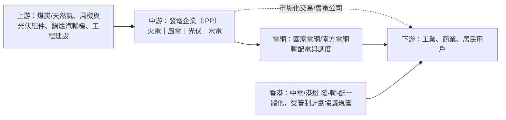

# 獨立電力生產商行業研究報告｜轉弱觀察

- **更新日**：2026-10-18（Asia/Hong_Kong）
- **Dashboard 標籤**：轉弱觀察｜行業組「獨立電力生產商」（Independent Power Producers）｜成份股 0006.HK 電能實業、0836.HK 華潤電力（n=2）
- **技術備註**：技術數據截至 2026-10-23，由 HK Indices DB 提供，本報告未重算。n=2；5d −0.1%、20d +3.3%；5d 廣度 50%（較前值 −50 ppt）。屬廣度收縮型轉弱。
- **資料新鮮度**：公司數據以 2025 年報（2026-03／04）及 2026 中期業績（2026-08）為主；行業統計至 2026 年 1–8 月（國家統計局 2026-09-28、國家能源局 2026-09）；市值以 2026-10-16 收市計。
- **非投資建議。**

**營運更新（2026-10-15）**：華潤電力公告 2026 年 9 月附屬電廠售電量同比 +9.0%，首九個月累計 +9.7%（光伏 +35.1%、火電 +10.3%、風電 +1.6%）。來源：HKEX 2026101500272_c.pdf。財務仍以 2026 中期為準，本報告未重寫基本面章節。

---

## 1. 產業運作方式

**產業範圍。** 內地「獨立電力生產商」指不擁有輸配電網、向電網企業售電的發電集團（五大六小央企及其上市平台，如華能國際、華潤電力、中國電力）。香港則為受《管制計劃協議》規管的垂直一體化電力公司（中電、港燈），電能實業屬持有港燈及海外受規管電網／發電資產的投資控股公司。

**行業規模。** 2026 年 1–8 月全社會用電量 71,730 億千瓦時（+4.3%）（來源 1）；截至 8 月底全國發電裝機 41.03 億千瓦（+11.1%），其中太陽能 12.99 億千瓦（+16.3%）、風電 6.93 億千瓦（+19.6%）（來源 2）。裝機增速遠超用電增速，利用小時與電價承壓。國家統計局口徑「電力、熱力生產和供應業」1–8 月營業收入 67,008.3 億元（+0.4%），利潤總額 4,462.5 億元（−15.1%）（來源 3）。

**主要商業模式。**
1. **火電**：收入＝上網電量×電價（中長期合約＋現貨＋容量電價），成本主要為燃料煤；盈利取決於「點火價差」（來源 4）。
2. **新能源（風、光）**：前期資本開支大、邊際成本近零；新增項目逐步全面入市，電價隨市場化與消納能力下行（來源 4）。
3. **水電／核電**：電價穩定、受來水影響（來源 6）。
4. **香港受規管模式**：按准許回報率（固定資產淨值）獲利，盈利與資本投資掛鈎（來源 5、7）。

**關鍵成功因素。** (i) 燃料採購與長協煤比例；(ii) 電源結構與區位（負荷中心、消納條件）；(iii) 電力市場交易能力；(iv) 融資成本及資本開支紀律；(v) 派息與資產循環（分拆、出售）。

---

## 2. 價值鏈分析

| 環節 | 特點 | 議價力 |
|---|---|---|
| 上游燃料 | 煤價決定火電成本 | 華能前五大供應商佔 48.69%（來源 8） |
| 發電 | 分散競爭，央企主導 | 電價受市場化交易壓制（來源 4、6） |
| 電網 | 壟斷買家 | 華潤電力前五大客戶（均為電網公司）佔 43.42%（來源 9） |

### 主要參與者（市值以 2026-10-16 收市計；HKD→USD 7.8476，來源 10）

#### (1) 華潤電力｜0836.HK｜Dashboard 成份股
- **簡介**：華潤集團旗下綜合能源公司，火電與可再生能源並重。2026H1 火電核心業務利潤約 30.65 億港元（+16.1%）、附屬售電量 +12.8%；燃煤平均上網電價約 364.0 元／MWh（−7.0%），點火價差約 119.5 元／MWh（收窄約 30.4 元）；可再生能源核心利潤約 39.07 億港元（−30.7%），整體純利約 −15.5%；華潤新能源推進 A 股上市（來源 4）。
- **主要客戶與營收占比**：2025 年前五大客戶佔 43.42%：國網江蘇 11.36%、國網湖北 9.68%、國網河南 9.29%、廣東電網 6.57%、國網華北分部 6.52%（來源 9）。
- **主要供應商**：前五大佔 15.70%：中車株洲所 5.17%、中煤能源南京 3.53%、國能銷售滄州 2.75%、上海綠地能源煤炭 2.28%、哈爾濱鍋爐 1.97%（來源 9）。
- **近 3 年營收與獲利**（港元億元；來源 11）

| 年度 | 2023 | 2024 | 2025 |
|---|---:|---:|---:|
| 營業額 | 1,033.3 | 1,052.8（+1.9%） | 1,020.1（−3.1%） |
| 淨利潤 | 110.0 | 143.9（+30.8%） | 145.2（+0.9%） |

- 2025 年分部：火電約 764.6 億港元、可再生能源約 255.5 億港元（來源 11）。
- **市值**：約 1,026.6 億港元 ≈ **131 億美元**（2026-10-16；來源 12）

#### (2) 電能實業｜0006.HK｜Dashboard 成份股
- **簡介**：長和系公用事業投資平台，持有港燈投資權益及英國、澳洲等地受規管電網、燃氣與發電資產，多數以合營／聯營入賬。2026H1 純利約 147.04 億港元，主要來自出售 UKPN 及 UK Rails 權益；中期息每股 0.78 港元（來源 13）。
- **主要客戶與營收占比**：最大客戶佔 33.8%、前五大佔 83.1%（為與長江基建等共同持有的合營公司）（來源 14）。
- **主要供應商**：最大供應商佔 14.7%、前五大佔 37.2%（來源 14）。
- **近 3 年營收與獲利**（港元億元；來源 15）

| 年度 | 2023 | 2024 | 2025 |
|---|---:|---:|---:|
| 綜合收入 | 12.9 | 9.2（−28.9%） | 7.7（−16.1%） |
| 淨利潤 | 60.0 | 61.2（+1.9%） | 62.4（+1.9%） |

- 註：主要資產以權益法入賬，綜合收入不反映業務規模；TTM 淨利潤約 179.0 億港元含出售收益（來源 15）。
- **市值**：約 1,290.4 億港元 ≈ **164 億美元**（2026-10-16；來源 16）

#### (3) 華能國際｜0902.HK／600011.SH
- **簡介**：中國華能集團旗下最大上市發電平台，火電為主並加速發展風光。2026H1 營業收入 1,069.09 億元（−4.57%）、歸母淨利潤 65.86 億元（−28.89%）；境內平均上網結算電價 463.02 元／MWh（−4.58%）、上網電量 1,995.78 億千瓦時（−2.97%）（來源 6）。
- **主要客戶與營收占比**：前五大客戶（國網山東、江蘇、浙江、江西及廣東電網）佔 38.15%，最大客戶國網山東約 13.4%（來源 8）。
- **主要供應商**：前五大（華能集團、中石油、中國電建、華陽新材料、中國能建）佔 48.69%，其中華能集團佔 34.42%（來源 8）。
- **近 3 年營收與獲利**（人民幣億元；來源 17）

| 年度 | 2023 | 2024 | 2025 |
|---|---:|---:|---:|
| 營業收入 | 2,544.0 | 2,455.5（−3.5%） | 2,292.9（−6.6%） |
| 淨利潤 | 55.3 | 72.1（+30.4%） | 116.4（+61.4%） |

- **市值**：約 1,254.5 億港元（SA 以 A+H 總股本乘 H 股價估算）≈ **160 億美元**（2026-10-16；來源 18）

#### (4) 中國電力｜2380.HK
- **簡介**：國家電投集團旗下港股發電平台，清潔能源裝機佔比超八成（來源 26）。2026H1 收入 224.57 億元（−5.87%）、權益持有人應佔利潤 15.08 億元（−46.81%）（來源 19）。
- **主要客戶與營收占比**：前五大客戶佔 50.83%，最大客戶佔 13.07%（來源 20）。
- **主要供應商**：前五大佔 38.84%，最大供應商佔 21.18%（來源 20）。
- **近 3 年營收與獲利**（人民幣億元；來源 21）

| 年度 | 2023 | 2024 | 2025 |
|---|---:|---:|---:|
| 收入 | 461.4 | 562.2（+21.8%） | 523.9（−6.8%） |
| 淨利潤 | 26.6 | 33.6（+26.3%） | 29.1（−13.4%） |

- **市值**：約 338.3 億港元 ≈ **43 億美元**（2026-10-16；來源 22）

#### (5) 中電控股｜0002.HK
- **簡介**：香港最大電力公司，業務覆蓋香港、內地、澳洲（EnergyAustralia）及印度。2026H1 營運盈利（計入公平價值變動前）57.33 億港元（+9.7%）、總盈利 59.97 億港元（+6.6%）；香港售電量 +3.6%（來源 7）。
- **主要客戶與營收占比**：五大客戶佔收入少於 30%（來源 23）。
- **主要供應商**：前五大佔 47.17%，包括 AEMO 13.04%、廣東核電 11.14%（來源 23）。
- **近 3 年營收與獲利**（港元億元；來源 24）

| 年度 | 2023 | 2024 | 2025 |
|---|---:|---:|---:|
| 收入 | 871.7 | 909.6（+4.3%） | 880.2（−3.2%） |
| 淨利潤 | 66.5 | 117.4（+76.5%） | 104.7（−10.8%） |

- **市值**：約 1,949.2 億港元 ≈ **248 億美元**（2026-10-16；來源 25）

---

## 3. 產業重要趨勢

1. **裝機過剩壓低電價**：裝機 +11.1% 遠高於用電 +4.3%（來源 1、2）；華能境內結算電價 −4.58%（來源 6），華潤燃煤電價 −7.0%（來源 4）。
2. **火電「量增價減」、價差收窄**：華潤火電售電 +16.9%，但點火價差收窄約 30.4 元／MWh（來源 4）。
3. **新能源量價雙壓**：華潤風電電價 −6.3%、光伏電價 −9.2%，可再生能源核心利潤 −30.7%（來源 4）；中國電力利潤近腰斬（來源 19）。
4. **行業利潤由升轉跌**：電力熱力業 1–8 月利潤 −15.1%（來源 3），與 2024–2025 年煤價回落帶來的盈利修復（華能 2025 年淨利 +61.4%，來源 17）形成反差。
5. **資產循環與分拆**：華潤新能源 A 股上市（來源 4）；電能出售英國資產回籠資金（來源 13）。
6. **香港受規管業務穩健**：中電香港售電量 +3.6%、營運盈利 +9.7%（來源 7）。

---

## 4. 未來 12 個月催化劑與風險

### 潛在正面
- **煤價回落**：若標煤價格下行，可修復火電價差（來源 4，推論）。
- **用電需求維持增長**：1–8 月用電 +4.3%（來源 1），AI 數據中心及電氣化或支撐負荷（推論）。
- **資本回收及特別派息**：電能出售所得資金的再投資或分派安排（來源 13）。
- **新能源分拆估值重估**：華潤新能源 A 股上市（來源 4）。
- **港電穩定回報**：受規管業務為防守型收入（來源 7）。

### 潛在負面
- **2027 年年度長協電價下調**：若裝機過剩延續，電價或進一步走低（推論，基於來源 2、6）。
- **新能源電價全面市場化**：利用小時及棄風棄光壓力（來源 4）。
- **行業盈利下行**：電力熱力業利潤 −15.1%（來源 3）。
- **電能盈利基數失真**：2026H1 純利含一次性出售收益（來源 13），2027 年同比基數高。
- **n=2 技術風險**：組內兩股商業模式差異大，訊號易受單股主導。

---

## 5. 資料限制
- Dashboard 分類把電能實業（投資控股）與華潤電力（內地 IPP）並列，商業模式不可直接比較。
- 華能、中國電力中期數據部分取自公司報告搜尋摘要及格隆匯報道，未逐項核對原文。
- 華能市值為 A+H 總股本乘 H 股價估算。
- 3 年財務為 S&P Global MI 標準化口徑；華潤電力以港元列示，與其人民幣經營數據存在匯率差異。
- 容量電價、現貨市場細則未逐省建模。
- 技術數據截至 2026-10-23，未重算。

## 6. 來源列表
| # | 機構／文件 | 日期 | URL |
|---|---|---|---|
| 1 | 國家能源局：8月份全社會用電量再破萬億 | 2026-09-20 | https://www.nea.gov.cn/20260920/bd277235282140f4b43e9e0f5f0af3d9/c.html |
| 2 | 中國能源新聞網：國家能源局發布 2026 年 1—8 月全國電力統計數據 | 2026-09-24 | https://www.cpnn.com.cn/news/nytt/202609/t20260924_1917579.html |
| 3 | 國家統計局：2026年1—8月份規模以上工業企業利潤 | 2026-09-28 | https://www.stats.gov.cn/sj/zxfb/202609/t20260928_1965425.html |
| 4 | 華潤電力 2026 中期業績公佈（HKEX） | 2026-08-26 | https://www.hkexnews.hk/listedco/listconews/sehk/2026/0826/2026082600196_c.pdf |
| 5 | 港燈電力投資 2026 中期業績公告 | 2026-08 | https://www.hkelectric.com/documents/zh/InvestorRelations/Documents/Interim%20Results/2026/C_2026_Interim_Results_Announcement.pdf |
| 6 | 華能國際 2026 年半年度報告 | 2026-08 | https://www.hpi.com.cn/ReportMA/%E5%8D%8E%E8%83%BD%E5%9B%BD%E9%99%852026%E5%B9%B4%E5%8D%8A%E5%B9%B4%E5%BA%A6%E6%8A%A5%E5%91%8A.pdf |
| 7 | 中電控股 2026 中期業績公告（HKEX） | 2026-08-06 | https://www1.hkexnews.hk/listedco/listconews/sehk/2026/0806/2026080600236_c.pdf |
| 8 | 華能國際 2025 年報（HKEX） | 2026-04-17 | https://www1.hkexnews.hk/listedco/listconews/sehk/2026/0417/2026041700841_c.pdf |
| 9 | 華潤電力 2025 年報（HKEX） | 2026-04-28 | https://www1.hkexnews.hk/listedco/listconews/sehk/2026/0428/2026042801638_c.pdf |
| 10 | TMA USD/HKD 即期匯率 7.8476 | 2026-10-16 | https://benchmark.tma.org.hk/benchmark/history/usd-hk-spot-rate |
| 11 | StockAnalysis：華潤電力財務摘要（S&P Global MI） | 2026-10-16 查閱 | https://stockanalysis.com/quote/hkg/0836/financials/ |
| 12 | StockAnalysis：華潤電力概覽（市值） | 2026-10-16 | https://stockanalysis.com/quote/hkg/0836/ |
| 13 | 電能實業 2026 中期業績公告（HKEX） | 2026-08-12 | https://www1.hkexnews.hk/listedco/listconews/sehk/2026/0812/2026081200405_c.pdf |
| 14 | 電能實業 2025 年報（HKEX） | 2026-04-21 | https://www1.hkexnews.hk/listedco/listconews/sehk/2026/0421/2026042100657_c.pdf |
| 15 | StockAnalysis：電能實業財務摘要 | 2026-10-16 查閱 | https://stockanalysis.com/quote/hkg/0006/financials/ |
| 16 | StockAnalysis：電能實業概覽 | 2026-10-16 | https://stockanalysis.com/quote/hkg/0006/ |
| 17 | StockAnalysis：華能國際財務摘要 | 2026-10-16 查閱 | https://stockanalysis.com/quote/hkg/0902/financials/ |
| 18 | StockAnalysis：華能國際概覽 | 2026-10-16 | https://stockanalysis.com/quote/hkg/0902/ |
| 19 | 格隆匯：中國電力上半年收入 224.57 億元 | 2026-08 | https://www.gelonghui.com/news/5290472 |
| 20 | 中國電力 2025 年報（HKEX） | 2026-04-24 | https://www1.hkexnews.hk/listedco/listconews/sehk/2026/0424/2026042400648_c.pdf |
| 21 | StockAnalysis：中國電力財務摘要 | 2026-10-16 查閱 | https://stockanalysis.com/quote/hkg/2380/financials/ |
| 22 | StockAnalysis：中國電力概覽 | 2026-10-16 | https://stockanalysis.com/quote/hkg/2380/ |
| 23 | 中電控股 2025 年報（HKEX） | 2026-03-11 | https://www1.hkexnews.hk/listedco/listconews/sehk/2026/0311/2026031100299_c.pdf |
| 24 | StockAnalysis：中電控股財務摘要 | 2026-10-16 查閱 | https://stockanalysis.com/quote/hkg/0002/financials/ |
| 25 | StockAnalysis：中電控股概覽 | 2026-10-16 | https://stockanalysis.com/quote/hkg/0002/ |
| 26 | 智通財經（Investing.com 轉載）：中國電力上半年水電強勁增長、清潔能源裝機佔比超八成 | 2026-08 | https://cn.investing.com/news/stock-market-news/article-3528544 |
